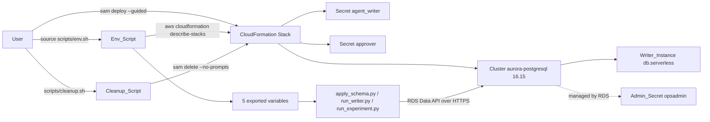

# Design Document

## Overview

This feature adds the files needed to run opsmem on Aurora PostgreSQL Serverless v2 and remove it afterwards. The Python code (`opsmem/db.py`) already reaches Aurora through the RDS Data API and reads `CLUSTER_ARN`, `ADMIN_SECRET_ARN`, `AGENT_WRITER_SECRET_ARN`, `APPROVER_SECRET_ARN` and `AWS_REGION`. It already retries `DatabaseResumingException`. No Python code under `opsmem/` changes.

New and changed files:

| File | Purpose |
| --- | --- |
| `template.yaml` | SAM template: Cluster, Writer_Instance, two Role_Secrets, four outputs |
| `scripts/env.sh` | Sourced script that exports the five variables |
| `scripts/cleanup.sh` | Runs `sam delete --no-prompts` and prints two notes |
| `README.md` | Part 1 steps for Aurora |
| `.gitignore` | Adds `samconfig.toml` |
| `pyproject.toml` | Adds pinned dev dependency `cfn-lint` |
| `tests/test_aws_template.py` | Template assertions and the `sam validate --lint` test |
| `tests/test_aws_scripts.py` | Env_Script and Cleanup_Script tests with Fake_Aws and Fake_Sam |
| `tests/test_aws_readme.py` | README heading order, required strings, pricing links, `.gitignore` check |

Design decisions:

- Engine `aurora-postgresql` version `16.15` and `MinCapacity: 0` (auto-pause after 600 seconds), so storage is the only cost between runs.
- The master user `opsadmin` password is managed by RDS (`ManageMasterUserPassword: true`). The Template defines no secret for it. Its ARN comes from `MasterUserSecret.SecretArn`.
- `agent_writer` and `approver` each get a template secret with a generated 32 character password without punctuation, because the Schema_Applier refuses passwords with punctuation.
- Both `DeletionPolicy` and `UpdateReplacePolicy` are `Delete`, so `sam delete` removes everything and no final snapshot is kept.
- The agent never runs AWS-mutating commands (`sam deploy`, `sam delete`, `scripts/cleanup.sh`). The user runs them. Tests never touch AWS.

## Architecture



The scripts reach the Cluster over the Data_API, so the Template defines no VPC, subnet group or security group and relies on the default VPC of the account.

## Components and Interfaces

### Template (`template.yaml`)

```yaml
AWSTemplateFormatVersion: "2010-09-09"
Transform: AWS::Serverless-2016-10-31
Description: opsmem on Aurora PostgreSQL Serverless v2 (Data API)

Resources:
  Cluster:
    Type: AWS::RDS::DBCluster
    DeletionPolicy: Delete
    UpdateReplacePolicy: Delete
    Properties:
      Engine: aurora-postgresql
      EngineVersion: "16.15"
      DatabaseName: opsmemory
      MasterUsername: opsadmin
      ManageMasterUserPassword: true
      EnableHttpEndpoint: true
      ServerlessV2ScalingConfiguration:
        MinCapacity: 0
        MaxCapacity: 2
        SecondsUntilAutoPause: 600

  WriterInstance:
    Type: AWS::RDS::DBInstance
    DeletionPolicy: Delete
    UpdateReplacePolicy: Delete
    Properties:
      DBClusterIdentifier: !Ref Cluster
      DBInstanceClass: db.serverless
      Engine: aurora-postgresql

  AgentWriterSecret:
    Type: AWS::SecretsManager::Secret
    Properties:
      GenerateSecretString:
        SecretStringTemplate: '{"username": "agent_writer"}'
        GenerateStringKey: password
        PasswordLength: 32
        ExcludePunctuation: true

  ApproverSecret:
    Type: AWS::SecretsManager::Secret
    Properties:
      GenerateSecretString:
        SecretStringTemplate: '{"username": "approver"}'
        GenerateStringKey: password
        PasswordLength: 32
        ExcludePunctuation: true

Outputs:
  ClusterArn:
    Value: !GetAtt Cluster.DBClusterArn
  AdminSecretArn:
    Value: !GetAtt Cluster.MasterUserSecret.SecretArn
  AgentWriterSecretArn:
    Value: !Ref AgentWriterSecret
  ApproverSecretArn:
    Value: !Ref ApproverSecret
```

Notes:

- The Template defines exactly one Cluster, one Writer_Instance, two secrets and four outputs. Nothing else.
- For `AWS::SecretsManager::Secret`, `!Ref` returns the secret ARN.
- Usernames are literal text in `SecretStringTemplate` (Requirement 2.2).
- The `sam validate --lint` run uses cfn-lint rules. The engine version and `MinCapacity: 0` must be accepted by the pinned `cfn-lint`. If a rule rejects either value, the implementation reports it to the user instead of changing the value.

### Env_Script (`scripts/env.sh`)

Interface: `source scripts/env.sh`, with optional `STACK` and `AWS_REGION`. It is sourced, so it does not call `exit` and does not use `set -e` in the caller shell.

```bash
# Source this file: source scripts/env.sh
STACK="${STACK:-agent-tool-errors}"
export AWS_REGION="${AWS_REGION:-us-east-1}"

_opsmem_output() {
  local value
  value="$(aws cloudformation describe-stacks --stack-name "$STACK" \
    --query "Stacks[0].Outputs[?OutputKey=='$1'].OutputValue" --output text)" || return 1
  if [ -z "$value" ] || [ "$value" = "None" ]; then
    echo "Missing stack output: $1" >&2
    return 1
  fi
  printf '%s\n' "$value"
}

CLUSTER_ARN="$(_opsmem_output ClusterArn)" || return 1
ADMIN_SECRET_ARN="$(_opsmem_output AdminSecretArn)" || return 1
AGENT_WRITER_SECRET_ARN="$(_opsmem_output AgentWriterSecretArn)" || return 1
APPROVER_SECRET_ARN="$(_opsmem_output ApproverSecretArn)" || return 1
export CLUSTER_ARN ADMIN_SECRET_ARN AGENT_WRITER_SECRET_ARN APPROVER_SECRET_ARN
unset -f _opsmem_output

echo "$CLUSTER_ARN"
```

Behavior:

- It reads only output values (ARNs). It never calls `secretsmanager`, so no secret value can be printed.
- Its only stdout line is the cluster ARN. Errors from `aws` go to stderr.
- With these variables exported and `OPSMEM_LOCAL_PG` unset, `AuroraBackend` is selected with no code change.
- `STACK` is not exported by the script; it is only used inside the shell.

### Cleanup_Script (`scripts/cleanup.sh`)

```bash
#!/usr/bin/env bash
set -euo pipefail
STACK="${STACK:-agent-tool-errors}"
sam delete --stack-name "$STACK" --no-prompts
echo "No final snapshot is kept: the database content is gone."
echo "Secrets Manager keeps deleted secrets for a recovery window before removing them."
```

`set -e` stops the script before the notes when `sam delete` fails, so the notes are printed only after the command completes. The script asks for no confirmation. The agent does not run it.

### Readme (`README.md`)

The heading `## Part 1: the database says no` stays unchanged. Inside it, in this order:

1. `### 1. Deploy the database`: `sam deploy --guided --stack-name agent-tool-errors`, then `source scripts/env.sh`, then one bullet per template choice with a one line reason (engine 16.15, Data API enabled, `MinCapacity` 0 with 600 second pause, `db.serverless` single writer, `Delete` policies, RDS-managed admin secret, two generated secrets with 32 characters and no punctuation).
2. `### 2. Apply the schema`: `uv run scripts/apply_schema.py`, what it creates, and the real output.
3. `### 3. Verify without spending`: existing text plus one sentence that the same command works on Aurora after `source scripts/env.sh`.
4. `### 4. One writer run`: existing text plus the same one sentence.
5. `### 5. Clean up`: `scripts/cleanup.sh` (or `sam delete`) and what it deletes.
6. `### Cost and operations`: storage is the only cost between runs with `MinCapacity: 0`; Serverless v2 is billed per ACU-hour and storage per GB-month, with links to the Aurora pricing page and the Bedrock pricing page and no hand-copied prices; the first call after a pause can raise `DatabaseResumingException`, which `opsmem/db.py` retries.

The real output of step 2 comes from a real deployment. The agent stops and asks the user to paste it. Only real output is documented.

### Repository configuration

- `.gitignore` gains the line `samconfig.toml`. No `samconfig.toml` is committed.
- `pyproject.toml` adds `cfn-lint==<exact version>` to the `dev` dependency group. The exact version is the latest release resolved when the task is implemented, and `uv.lock` is updated.

### Tests

`tests/test_aws_template.py`:

```python
import shutil, subprocess
from pathlib import Path
import pytest
from cfnlint.decode.cfn_yaml import load  # CloudFormation-tag aware loader from cfn-lint

TEMPLATE = Path(__file__).resolve().parent.parent / "template.yaml"

def load_template() -> dict:
    return load(str(TEMPLATE))   # returns (template, matches) in some cfn-lint versions

@pytest.mark.skipif(shutil.which("sam") is None, reason="sam not on PATH")
def test_sam_validate_lint():
    result = subprocess.run(["sam", "validate", "--lint", "-t", str(TEMPLATE)],
                            capture_output=True, text=True)
    assert result.returncode == 0, result.stdout + result.stderr
```

The exact loader entry point is confirmed against the pinned `cfn-lint` version during implementation. If it returns a tuple, the helper unwraps it. A fallback is a `yaml.SafeLoader` subclass with constructors for `!Ref`, `!GetAtt`, `!Sub` and the other short tags, but the cfn-lint loader is the specified choice.

Template tests assert, on the parsed document:

- one `AWS::RDS::DBCluster` with the engine, version, database name, master user, `ManageMasterUserPassword`, `EnableHttpEndpoint` and the three scaling values;
- exactly one `AWS::RDS::DBInstance` with class `db.serverless`;
- `DeletionPolicy` and `UpdateReplacePolicy` equal to `Delete` on both;
- exactly two `AWS::SecretsManager::Secret` resources whose `SecretStringTemplate` usernames are `agent_writer` and `approver`, with `PasswordLength` 32 and `ExcludePunctuation` true, and no secret for `opsadmin`;
- the output keys are exactly the four names, and each value refers to the matching resource.

`tests/test_aws_scripts.py` uses `tmp_path` to build a directory with executable `aws` or `sam` shell stubs and prepends it to `PATH`.

- Fake_Aws: reads `--stack-name` and the output key from `--query`, appends its arguments to a log file, and prints the value from environment variables `FAKE_<KEY>` (for example `FAKE_ClusterArn`). It also fails the test if invoked with a `secretsmanager` subcommand.
- Fake_Sam: appends its argv to a log file and exits 0.
- Env_Script runs as `bash -c 'source scripts/env.sh >out; env'` style subprocess: stdout is captured, and the exported variables are read back with `env -0`.
- Cleanup_Script runs as `bash scripts/cleanup.sh` with the Fake_Sam first on `PATH`.

`tests/test_aurora_smoke.py` is not modified.

## Data Models

Stack outputs consumed by the Env_Script:

| Output key | Environment variable | Source |
| --- | --- | --- |
| `ClusterArn` | `CLUSTER_ARN` | `Cluster.DBClusterArn` |
| `AdminSecretArn` | `ADMIN_SECRET_ARN` | `Cluster.MasterUserSecret.SecretArn` |
| `AgentWriterSecretArn` | `AGENT_WRITER_SECRET_ARN` | `AgentWriterSecret` |
| `ApproverSecretArn` | `APPROVER_SECRET_ARN` | `ApproverSecret` |

Role secret JSON (generated by Secrets Manager): `{"username": "<role>", "password": "<32 characters, no punctuation>"}`.

Fake_Aws log line: one line per call with the full argument list. Fake_Sam log line: one line per call with the full argument list.

## Error Handling

- `aws cloudformation describe-stacks` fails (stack missing, no credentials): the Env_Script returns 1 from the `source` and leaves its error on stderr. Variables not yet assigned stay unset. Nothing is printed to stdout.
- An output is missing: `--output text` returns `None` for an empty query result. The Env_Script treats an empty or `None` value as a failure, prints a message naming the missing output key on stderr, and returns 1.
- `sam delete` fails: `set -e` stops the Cleanup_Script and no note is printed.
- `sam` absent on a developer machine: only the `sam validate --lint` test is skipped. Other tests are unaffected.
- First call after pause: `DatabaseResumingException` is retried by `opsmem/db.py` (waits 5 to 30 seconds). The README documents this.
- Lint rejects the engine version or `MinCapacity: 0`: report to the user and do not change the values.

## Correctness Properties

*A property is a characteristic or behavior that should hold true across all valid executions of a system-essentially, a formal statement about what the system should do. Properties serve as the bridge between human-readable specifications and machine-verifiable correctness guarantees.*

Template, README and `.gitignore` criteria (Requirements 1, 2, 3, 6) are static content and are covered by example-based tests. The `sam validate --lint` run is a smoke test. Requirement 4.8 needs a real cluster and stays with the unchanged Aurora_Smoke_Test. Properties apply to the scripts, whose behavior varies with the stack name, region and output values. They run against Fake_Aws and Fake_Sam, so they cost no AWS calls.

Reflection: the default stack name (4.2) and the default region (4.5) are single examples and remain unit tests. Export mapping (4.3) and the output contract (4.6, 4.7) are kept as separate properties because one checks environment state and the other checks stdout.

### Property 1: Stack name is passed through

For any valid stack name set in `STACK`, sourcing the Env_Script SHALL call `aws cloudformation describe-stacks` with `--stack-name` equal to that name for each of the four outputs.

**Validates: Requirements 4.1**

### Property 2: Outputs map to exported variables

For any four ARN strings returned by the Fake_Aws for `ClusterArn`, `AdminSecretArn`, `AgentWriterSecretArn` and `ApproverSecretArn`, sourcing the Env_Script SHALL export `CLUSTER_ARN`, `ADMIN_SECRET_ARN`, `AGENT_WRITER_SECRET_ARN` and `APPROVER_SECRET_ARN` with exactly those values respectively.

**Validates: Requirements 4.3**

### Property 3: Only the cluster ARN is printed

For any four ARN strings returned by the Fake_Aws, the stdout of sourcing the Env_Script SHALL equal the cluster ARN followed by a newline, SHALL NOT contain any of the other three ARNs, and SHALL NOT contain any secret value (the Fake_Aws fails any `secretsmanager` call).

**Validates: Requirements 4.6, 4.7**

### Property 4: Region is exported and preserved

For any region string set in `AWS_REGION`, sourcing the Env_Script SHALL export `AWS_REGION` with that same value. When `AWS_REGION` is unset, the Env_Script SHALL export `us-east-1`.

**Validates: Requirements 4.4, 4.5**

### Property 5: Cleanup deletes the named stack without prompting

For any valid stack name set in `STACK`, running the Cleanup_Script SHALL call `sam` exactly once with the arguments `delete --stack-name <name> --no-prompts`, and SHALL print the no-snapshot line and the recovery-window line after the call.

**Validates: Requirements 5.1, 5.2, 5.3**

## Testing Strategy

Dual approach: example-based tests for static files, property-based tests for the two scripts.

- Property-based tests use `hypothesis` (already a dev dependency), with at least 100 iterations per property (`@settings(max_examples=100)`). Generators: stack names matching `[A-Za-z][A-Za-z0-9-]{0,127}`, ARN-like strings from a restricted alphabet (`arn:aws:...` with letters, digits, `:`, `/`, `-`), and region strings like `[a-z]{2}-[a-z]+-[0-9]`.
- Each property test carries a tag comment: `# Feature: aws-deploy, Property N: <property text>`.
- Each iteration spawns a subprocess, so the stubs live in a module-level temporary directory created once, and per-iteration values are passed through environment variables, not rewritten files.
- Example tests cover: every Template assertion of Requirements 1 to 3, no `opsadmin` secret, default `STACK` equals `agent-tool-errors`, README heading order and required strings, `.gitignore` contains `samconfig.toml`, and no `samconfig.toml` in the repository.
- Smoke test: `sam validate --lint`, skipped when `sam` is not on `PATH`.
- No test calls AWS. The agent runs only `pytest` and never `sam deploy`, `sam delete` or `scripts/cleanup.sh` against a real account.
- Not tested offline: Requirement 4.8 and the real output of README step 2, which come from a real deployment run by the user.
