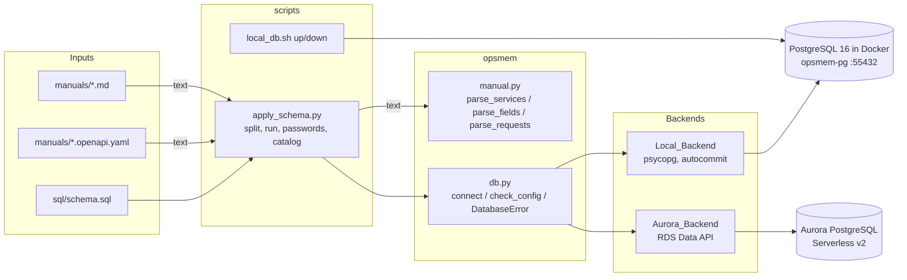
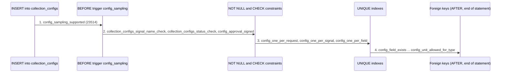
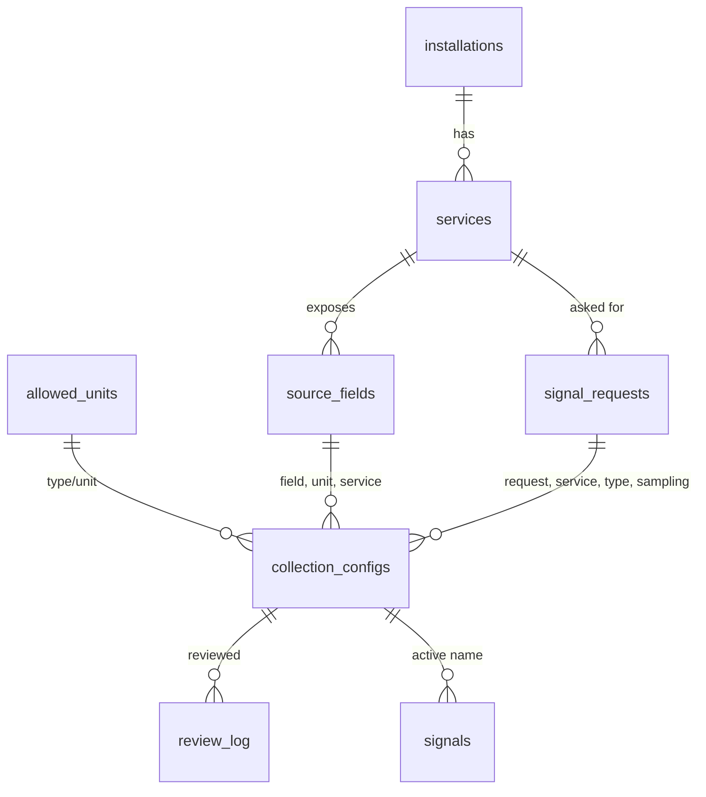

# Design Document

## Overview

This design covers the database layer of the project: the PostgreSQL schema that holds every rule for collection configurations, the `connect(role)` module that reaches it on Aurora or on local Docker, the scripts that start the local database and apply the schema, and the deterministic parsers that load the catalog from `manuals/`.

The idea behind the whole design is that PostgreSQL is the only place where rules live. The agent writes rows. The database accepts or rejects them, and each rejection carries a stable name that a later layer turns into an instruction. For that reason the names, messages, ERRCODEs and orders in the requirements are treated as a byte-for-byte contract. Nothing in this design renames or reorders them.

Key design decisions:

- One `Database_Object` interface (`run(sql, **params) -> list[list]` plus `DatabaseError`) with two backends. All SQL in the repo uses Data API style `:name` parameters, and the Local_Backend translates them to psycopg style.
- `DatabaseError` is a class owned by `opsmem/db.py`, not a vendor class. Both backends wrap their native SQL error in it, which is the only way to give both backends the same class (Requirement 1.5). The wrapper keeps the native text untouched: `str(err)` equals `str(native)` character for character, DETAIL lines included, and the native exception is chained as `__cause__` (Requirement 1.9). The tool layer shows this text to the model in raw mode, reads the constraint name from it in instructive mode, and the trace stores it, so no backend may prefix, trim or rewrite it.
- Rule precedence (Requirement 9) is not coded. It is a consequence of how PostgreSQL orders its checks, and the DDL is written so that the declaration order produces the required order. Section "Rule precedence mechanics" explains each step and its one fragile point.
- The sampling rule is a BEFORE trigger, so it runs before every constraint. The transition and signal rules are triggers because they depend on the old row, the current user, or another table.
- The schema file is split on a dedicated separator line, because the Data API accepts one statement per call and function bodies contain semicolons.
- The schema is always applied to a new, empty database. `local_db.sh up` recreates the local one and Aurora gets a new stack. `apply_schema.py` checks for an existing schema before it runs any statement and refuses to continue, so the schema file and the catalog load use plain statements: no `IF NOT EXISTS`, no `CREATE OR REPLACE`, no upsert.
- The parsers take the text of a file and read no file. The Catalog_Loader reads the files and passes the text.

Out of scope, as in the requirements: the tool layer (`errors.py`), the agent (`writer.py`), the experiment scripts and AWS deployment.

### Research summary

The design relies on these PostgreSQL and Data API behaviours. Sources are linked. The two items marked "verify" are checked by integration tests (see Testing Strategy), not assumed.

- Row-level BEFORE triggers run before NOT NULL and CHECK constraint evaluation. Constraints are then evaluated before index insertion, so CHECK errors come before UNIQUE errors. UNIQUE violations are raised during the insert, while foreign keys are enforced by AFTER triggers at the end of the statement, so UNIQUE errors come before foreign key errors. See [CREATE TRIGGER](https://www.postgresql.org/docs/16/sql-createtrigger.html) and [Trigger behavior](https://www.postgresql.org/docs/16/trigger-definition.html).
- Triggers on the same event fire in alphabetical order by trigger name ([CREATE TRIGGER](https://www.postgresql.org/docs/16/sql-createtrigger.html)). Foreign keys are implemented as internal triggers named `RI_ConstraintTrigger_c_<oid>`, so their order follows creation order as long as the OIDs have the same number of digits (verify).
- CHECK constraints on one table are evaluated in alphabetical order by name ([CREATE TABLE notes](https://www.postgresql.org/docs/16/sql-createtable.html)). Requirement 9 only fixes CHECK before UNIQUE, so the order among CHECKs is not part of the contract.
- A trigger function declared `SECURITY DEFINER` runs with the rights of its owner. Without it, `current_user` inside the function is the invoking role, which the transition rule needs ([CREATE FUNCTION](https://www.postgresql.org/docs/16/sql-createfunction.html)).
- `RAISE ... USING ERRCODE, CONSTRAINT` sets the SQLSTATE and the constraint name of the error ([PL/pgSQL errors](https://www.postgresql.org/docs/16/plpgsql-errors-and-messages.html)).
- Column-level privileges (`GRANT INSERT (col, ...)`, `GRANT UPDATE (col)`) are supported ([GRANT](https://www.postgresql.org/docs/16/sql-grant.html)). Default expressions such as `current_user` are evaluated without a column privilege on the defaulted column.
- The RDS Data API executes one statement per call, takes typed parameters, returns each cell as a one-key field object, and reports SQL errors as `BadRequestException`. A paused Serverless v2 cluster raises `DatabaseResumingException`. See [Data API](https://docs.aws.amazon.com/AmazonRDS/latest/AuroraUserGuide/data-api.html) and the [boto3 rds-data reference](https://boto3.amazonaws.com/v1/documentation/api/latest/reference/services/rds-data.html). Whether the SQLSTATE and constraint name appear in the `BadRequestException` message is checked by an Aurora integration test (verify). The db layer does not parse that message. The trigger messages start with the constraint name for this reason, so the tool layer can read the name from the message text on either backend.
- The official `postgres` Docker image logs `PostgreSQL init process complete; ready for start up.` after initialization. During initialization the server listens on the Unix socket only, so a TCP `pg_isready` that succeeds means the final server is up ([image docs](https://hub.docker.com/_/postgres)).

Content was rephrased for compliance with licensing restrictions.

## Architecture



Layers and what each one owns:

| Layer | Owns | Does not own |
|---|---|---|
| `sql/schema.sql` | Tables, named constraints, triggers, roles, grants, `allowed_units` rows | Role passwords, catalog rows |
| `opsmem/db.py` | Role validation, backend choice, parameter binding, retry, error class | Any SQL text |
| `opsmem/manual.py` | Turning the text of the manual and the OpenAPI file into plain values | Reading files, any database access |
| `scripts/apply_schema.py` | Refusing a non-empty database, splitting and running the schema, setting passwords, reading the manual files, loading the catalog | Rules |
| `scripts/local_db.sh` | The lifecycle of the `opsmem-pg` container | Schema |

### Rule precedence mechanics

Requirement 9 asks for a predictable rule when one insert breaks several. The order below is the order in which PostgreSQL itself reports them. The design keeps it by declaring objects in the right order and adds no application logic.



| Step | Why it comes here | What the DDL must do |
|---|---|---|
| Sampling trigger | BEFORE ROW triggers run first | Create it BEFORE INSERT OR UPDATE OF source_field, sample_s (Requirement 10.1) |
| CHECK | Evaluated before index insertion | Name all three CHECKs explicitly so the reported name is stable |
| UNIQUE | Raised while inserting into the unique index | Declare the three UNIQUE constraints in the order of Requirement 8.9 to 8.11, because indexes are maintained in creation order |
| Foreign keys | AFTER triggers, fired by name, which follows creation order | Declare the eight foreign keys in the order of Requirement 8.1 to 8.8 inside one `CREATE TABLE` |

The one fragile point is the foreign key order. The internal trigger names embed the constraint OID as decimal text, and names are compared as strings. Eight consecutive OIDs sort numerically unless they cross a digit boundary (for example 99999 to 100000). This cannot happen on the fresh database that `local_db.sh up` and a new Aurora cluster provide, and it is covered by a test that violates all eight foreign keys one by one (Testing Strategy). If that test fails, recreate the database with `scripts/local_db.sh up` and run it again.

## Components and Interfaces

### `opsmem/db.py`

```python
ROLES = ("admin", "agent_writer", "approver")

class DatabaseError(Exception):
    # str(err) == str(native exception), character for character (Requirement 1.9).
    # No prefix, no trimming, DETAIL lines kept. Built as
    #     raise DatabaseError(str(native), sqlstate=..., constraint=...) from native
    # so err.__cause__ is the native exception.
    sqlstate: str | None     # e.g. "23503"; None if the backend does not report it
    constraint: str | None   # None if the backend does not report it

    def __init__(self, text, *, sqlstate=None, constraint=None):
        super().__init__(text)          # args == (text,), so str(err) == text
        self.sqlstate = sqlstate
        self.constraint = constraint

class Database:                      # returned by connect(role)
    DatabaseError = DatabaseError    # Requirement 1.5, same class on both backends
    role: str
    def run(self, sql: str, **params) -> list[list]: ...

def connect(role) -> Database: ...
def check_config(required: list[str]) -> None: ...
```

Behaviour:

- `connect(role)`:
  - Checks `type(role) is str and role in ROLES` first. Anything else (None, "", "Admin", 3) raises `ValueError(f"Invalid role: {role!r}")` before any I/O (Requirement 1.10).
  - Returns `LocalBackend(role)` when `os.environ.get("OPSMEM_LOCAL_PG")` is non-empty, otherwise `AuroraBackend(role)` (Requirements 1.2, 1.3).
- Shared parameter scanner `scan_params(sql) -> list[Token]`. It walks the SQL once and yields text tokens and `:name` tokens. It skips single-quoted strings, dollar-quoted bodies and comments, leaves `::` untouched, and treats `:` followed by a letter or underscore as a parameter only when the previous character is not `:` or a word character. Both backends use it, so they agree on what a parameter is.
- Before executing, `run` compares the set of `:name` tokens to `params`. A name with no keyword argument raises `ValueError(f"Missing parameter: {name}")` and nothing is executed (Requirement 1.7). Extra keyword arguments are ignored.
- `run` returns `[]` for statements that produce no rows (Requirement 1.4).

Local_Backend:

- `parse_local_pg(value) -> tuple[str, int]` accepts exactly `host:port` with a non-empty host and an integer port from 1 to 65535. Anything else raises `ConfigError` saying `OPSMEM_LOCAL_PG` is missing or malformed. It runs in `connect`, before a socket is opened (Requirement 3.2).
- Credentials: `admin` uses `postgres/postgres`, `agent_writer` uses `agent_writer/agent_writer`, `approver` uses `approver/approver`. Database `opsmemory` (Requirements 3.3 to 3.5).
- The connection is opened with `psycopg.connect(..., autocommit=True, connect_timeout=10)`. A failure raises `ConnectionFailed(f"cannot connect to {host}:{port} as {role}: {cause}")` with no retry (Requirements 3.6, 3.10).
- Conversion to psycopg style is token based: each `:name` becomes `%(name)s`, and every literal `%` in a text token becomes `%%`. Casts are text tokens, so `::int` is kept (Requirements 3.7 to 3.9). The query is always executed with a params dict, so the `%%` escape is always valid.
- `psycopg.Error` is wrapped as `raise DatabaseError(str(e), sqlstate=e.diag.sqlstate, constraint=e.diag.constraint_name) from e`. The text is `str(e)` unchanged, so DETAIL lines are kept (Requirement 1.9). The two attributes come from `e.diag` and are None when psycopg reports none. The `psycopg` import is lazy so Aurora users do not need the `local` dependency group.
- Intended for local Docker only (Requirement 3.11). The module docstring says so.

Aurora_Backend:

- Secret ARN variables: `ADMIN_SECRET_ARN`, `AGENT_WRITER_SECRET_ARN`, `APPROVER_SECRET_ARN`. Cluster: `CLUSTER_ARN`. Database: `opsmemory` (Requirements 2.1, 2.2).
- A missing or empty variable raises `ConfigError(f"Missing environment variable: {name}")` before any Data API call (Requirement 2.6). The check runs when a statement is about to be sent, and it only looks at the variables that statement needs.
- Each `execute_statement` call uses only the secret of the bound role (Requirement 2.3). The boto3 client is created lazily with `AWS_REGION`.
- Parameter conversion to Data API fields: `None` becomes `isNull`, `bool` becomes `booleanValue`, `int` becomes `longValue`, `float` becomes `doubleValue`, `str` becomes `stringValue`. `bool` is tested before `int`. Result cells are converted back by the key present. All other cell types arrive as strings; callers that need timestamps cast in SQL.
- Retry loop:

```python
RETRY_WAITS = (5, 10, 15, 20, 25, 30)

for attempt in range(len(RETRY_WAITS) + 1):
    try:
        return client.execute_statement(...)
    except client.exceptions.DatabaseResumingException:
        if attempt == len(RETRY_WAITS):
            raise                      # Requirement 2.5, same type
        _sleep(RETRY_WAITS[attempt])  # Requirement 2.4
```

  `_sleep` is a module attribute so tests replace it.
- `BadRequestException` is a SQL error and is wrapped as `raise DatabaseError(str(e), sqlstate=..., constraint=...) from e`. The text is `str(e)` unchanged: it is not parsed, trimmed, prefixed or rewritten (Requirement 1.9). `sqlstate` and `constraint` are taken only from structured values on the exception object when it carries them, and are None otherwise. The Data API error reports a code and a message only, so they are normally None on Aurora, and the tool layer reads the constraint name from the text. Every other exception, including throttling and access denied, propagates unchanged and is not retried (Requirement 2.7). This reading of "database error" in Requirement 1.8 is deliberate: Requirement 2.7 requires non-SQL failures to propagate as they are.

`check_config(required)`:

```python
def check_config(required):
    if os.environ.get("OPSMEM_LOCAL_PG"):
        required = ["OPSMEM_LOCAL_PG", "AWS_REGION"]          # Requirement 4.3
    missing = [n for n in required if not os.environ.get(n)]  # absent or empty, Req 4.1, 4.2
    if missing:
        sys.stderr.write("Configuration error, agent not started. Missing: " + ", ".join(missing) + "\n")
        raise SystemExit(1)
```

The separator inside `<names>` is `", "` (comma and one space). The requirement says "comma-separated" without fixing the space, so this is the one place where I chose a form. Change it here and in the test together if the downstream tool expects a bare comma.

### `scripts/local_db.sh`

- `up`: `docker rm -f opsmem-pg` with output discarded (succeeds when the container is absent), then `docker run -d --name opsmem-pg -e POSTGRES_PASSWORD=postgres -e POSTGRES_DB=opsmemory -p 55432:5432 postgres:16`. If `docker run` fails, print the cause to stderr, print no `export` line, exit non-zero (Requirement 5.7).
- Wait loop, 1 second per poll, 60 seconds from container start in total: first until `docker logs opsmem-pg 2>&1` contains `PostgreSQL init process complete; ready for start up.`, then until `pg_isready -h localhost -p 55432` succeeds. If the host has no `pg_isready`, the script runs it through `docker exec opsmem-pg pg_isready -h localhost -p 5432` and still requires the init line first. On timeout: message to stderr that says readiness timeout, container left in place, no `export` line, non-zero exit (Requirement 5.6).
- Success prints only `export OPSMEM_LOCAL_PG=localhost:55432` to stdout and exits 0. Everything else (progress, errors) goes to stderr so `eval "$(scripts/local_db.sh up)"` is safe.
- `down`: `docker rm -f opsmem-pg`, always exit 0.
- No argument or another argument: usage line listing `up` and `down` on stderr, no container touched, non-zero exit (Requirement 5.8).

### `sql/schema.sql` and statement splitting

- Statements are separated by a line whose whole content, after trimming, is `-- @@ --`. Function bodies use `$$` quoting and contain semicolons, so splitting on `;` is not possible. A comment line or a function body can only be confused with the separator if it equals that whole line, which a test forbids by checking that the marker never appears except as a full line (Requirement 14.4).
- The file avoids `::` casts and avoids a colon directly followed by a letter in comments and literals. The Data API may treat such text as a parameter. Messages written as `name: text` have a space after the colon.
- Ordering inside the file: roles, tables, `allowed_units` rows, functions, triggers, grants.
- Plain statements only: `CREATE ROLE`, `CREATE TABLE`, `INSERT` for `allowed_units`, `CREATE FUNCTION`, `CREATE TRIGGER` and `GRANT`. The file is written for an empty database. Protection against a second run is the job of the applier check (Requirement 14.9), not of the SQL.

### `scripts/apply_schema.py`

Flow:

1. `check_config` for the variables the chosen backend needs. For Aurora this includes `CLUSTER_ARN`, `ADMIN_SECRET_ARN`, `AGENT_WRITER_SECRET_ARN`, `APPROVER_SECRET_ARN`, `AWS_REGION`.
2. `connect("admin")`, then the already-applied check `SELECT to_regclass('public.installations')`. This is the first statement sent and it comes before any schema statement. Aurora does not open a connection in `connect`, so this query is also what detects a connection failure. If it fails, the applier runs no schema statement, prints the connection error and exits non-zero (Requirement 14.1, 14.2). If it returns a value other than NULL, the schema already exists: the applier applies nothing, prints that the database is not empty and how to recreate it (`scripts/local_db.sh up` for the Local_Backend, a new stack for the Aurora_Backend), and exits non-zero (Requirement 14.9).
3. `split_statements(text) -> list[Statement]`, where `Statement` holds `sql`, its 1-based `index` and the `start_line`. Chunks with no SQL other than comments or whitespace are dropped.
4. Run statements one per call, in file order. On the first failure print the statement text, its index and start line, and the database error, then exit non-zero without running later statements (Requirement 14.5, 14.8).
5. Set role passwords. The statement text is built as `ALTER ROLE <role> PASSWORD '<password>'`, with the role taken from the fixed list. Local passwords equal the role names (Requirement 14.6). On Aurora the password is read from the role secret (`secretsmanager:GetSecretValue`, field `password`) (Requirement 14.7). Because the `Database_Object` has no way to bind a value into DDL, the script accepts only passwords that match `[A-Za-z0-9]+`, so no quote, colon or percent can reach the parameter scanner, and refuses anything else with a message that names the secret to regenerate without punctuation.
6. Run the Catalog_Loader (next section) as part of the same first application (Requirement 15.7).

### Catalog_Loader and `opsmem/manual.py`

```python
MANUAL  = "manuals/course-platform-install-07.md"
OPENAPI = "manuals/course-platform-install-07.openapi.yaml"

@dataclass(frozen=True)
class Service: service_id: str; name: str
@dataclass(frozen=True)
class Field:   service_id: str; field_name: str; unit: str; min_sample_s: int; max_sample_s: int
@dataclass(frozen=True)
class Request: request_id: str; service_id: str; signal_type: str; sample_s: int; request_text: str

class ManualError(ValueError): ...

def parse_services(openapi_text: str) -> list[Service]: ...
def parse_fields(openapi_text: str) -> list[Field]: ...
def parse_requests(manual_text: str) -> list[Request]: ...
```

The parsers take the text of a file as a string, return a list and open no file (Requirement 16.1). `MANUAL` and `OPENAPI` are only paths; the Catalog_Loader reads those two files and passes the text to the parsers (Requirement 16.2). Tests pass the text of the real files for the happy path and small inline strings for error cases. The dataclasses are frozen, so equality is element by element (Requirement 16.3).

Parsing rules, grounded in the files in `manuals/`:

- Services: one per entry of `tags`, in file order. `service_id` is the tag `name`, `name` is the tag `description`. For the OpenAPI file this gives `media, encoding, api, classes, queue` (5).
- Fields: for each path that has a `get` operation and ends in `/stats`, read `responses["200"].content["application/json"].schema`, resolve `$ref`, and read `properties`. The service is `tags[0]` of the operation. `x-unit`, `x-sampling-min-s` and `x-sampling-max-s` are required; a sampling value must be an integer and not a boolean. The file gives 9 fields (2 + 2 + 2 + 1 + 2).
- `$ref` resolution: only local pointers (`#/a/b/c`). A pointer that does not resolve raises `ManualError` naming the reference. A reference chain is followed with a depth limit so a cycle raises instead of looping (Requirement 16.4, 16.5).
- Missing tags raise `ManualError("tags missing")`. No GET stats response raises `ManualError("GET stats responses missing")` (Requirement 16.8). A stats operation without a tag, or a tag that is not in `tags`, raises an error naming the operation (Requirement 15.9).
- Requests: find the line `## Requests from operations`, read the first pipe table after it, skip the header and the `|---|` separator, and read the data rows. Cells are stripped and backticks removed. The sampling cell must match `^(\d+)\s*s$`. A row with fewer cells than the header raises an error naming the row. A missing heading raises an error naming the section. A heading with no rows raises an error that names the section and says no rows were found (Requirements 16.6, 16.7). For the manual this gives `R1` to `R6`, with `R5` at 60 s.
- Parsing is pure: no clock, no randomness, no network. The same files give equal results (Requirement 16.3).

Catalog load (inside `apply_schema.py`):

1. Probe `SELECT to_regclass('public.installations')`. A `NULL` result means the schema was not applied and the loader prints that and exits non-zero (Requirement 15.8).
2. Read the file at `OPENAPI` and the file at `MANUAL` as text, then pass the text to the parsers (Requirements 15.2 to 15.4). A missing or unreadable file is reported by name and the loader exits non-zero (Requirement 15.8). Parse everything before writing: if any parser raises, nothing is written (Requirements 15.8, 15.9).
3. Insert into the empty catalog in dependency order, one plain `INSERT` per row, with no `ON CONFLICT` clause (Requirement 15.7):
   - `installations`: `install-07`, `Course platform, installation 07` (Requirement 15.1).
   - `services`, then `source_fields`, then `signal_requests`, each with `installation_id = 'install-07'`.
4. Print four lines and exit 0:

```
installations: 1
services: 5
fields: 9
requests: 6
```

The Data API cannot span statements in one transaction through `run`, so a failure in the middle leaves a partial catalog. There is no repair by rerun, because inserts are plain and the already-applied check refuses a second run. The remedy is to recreate the database (`scripts/local_db.sh up`, or a new stack). The files in `manuals/` are only opened for reading (Requirement 15.6).

## Data Models

### Entity relationships



The last edge is enforced by the Signal_Trigger, not by a foreign key.

### Catalog tables (Requirement 6)

| Table | Columns | Keys and constraints |
|---|---|---|
| `installations` | `installation_id` text, `name` text NOT NULL | PK `installation_id` |
| `services` | `installation_id`, `service_id`, `name` NOT NULL | PK `(installation_id, service_id)`, FK `installation_id` to `installations` |
| `source_fields` | `installation_id`, `service_id` NOT NULL, `field_name`, `unit` NOT NULL, `min_sample_s` integer NOT NULL, `max_sample_s` integer NOT NULL | PK `(installation_id, field_name)`, UNIQUE `(installation_id, field_name, unit)`, UNIQUE `(installation_id, service_id, field_name)`, FK `(installation_id, service_id)` to `services` |
| `signal_requests` | `installation_id`, `request_id`, `service_id` NOT NULL, `signal_type` NOT NULL, `sample_s` integer NOT NULL, `request_text` NOT NULL | PK `(installation_id, request_id)`, UNIQUE on each of `(installation_id, request_id, service_id)`, `(installation_id, request_id, signal_type)`, `(installation_id, request_id, sample_s)`, FK `(installation_id, service_id)` to `services` |
| `allowed_units` | `signal_type`, `unit` | PK `(signal_type, unit)` |

The three extra UNIQUE constraints on `signal_requests` and the two on `source_fields` exist only so the configuration table can reference them with composite foreign keys that bind several columns to the same row.

`allowed_units` is loaded by the schema file with exactly: `latency/ms`, `latency/s`, `ratio/percent`, `count/count`, `age/s` (Requirement 6.10). This matches the signal type table in the manual.

### `collection_configs` (Requirements 7 and 8)

```sql
CREATE TABLE collection_configs (
    config_id       SERIAL PRIMARY KEY,
    run_id          text    NOT NULL,
    installation_id text    NOT NULL,
    request_id      text    NOT NULL,
    service_id      text    NOT NULL,
    signal_name     text    NOT NULL,
    signal_type     text    NOT NULL,
    source_field    text    NOT NULL,
    unit            text    NOT NULL,
    sample_s        integer NOT NULL,
    model_id        text    NOT NULL,
    status          text    NOT NULL DEFAULT 'draft',
    created_by      text    NOT NULL DEFAULT current_user,
    approved_by     text,
    is_bait         boolean NOT NULL DEFAULT false,

    CONSTRAINT collection_configs_signal_name_check
        CHECK (signal_name ~ '^[a-z][a-z0-9_]{2,40}$'),
    CONSTRAINT collection_configs_status_check
        CHECK (status IN ('draft','needs_review','approved','rejected','active')),
    CONSTRAINT config_approval_signed
        CHECK (status NOT IN ('approved','active') OR approved_by IS NOT NULL),

    CONSTRAINT config_one_per_request UNIQUE (run_id, installation_id, request_id),
    CONSTRAINT config_one_per_signal  UNIQUE (run_id, installation_id, signal_name),
    CONSTRAINT config_one_per_field   UNIQUE (run_id, installation_id, source_field),

    CONSTRAINT config_field_exists FOREIGN KEY (installation_id, source_field)
        REFERENCES source_fields (installation_id, field_name),
    CONSTRAINT config_unit_matches_source FOREIGN KEY (installation_id, source_field, unit)
        REFERENCES source_fields (installation_id, field_name, unit),
    CONSTRAINT config_answers_request FOREIGN KEY (installation_id, request_id)
        REFERENCES signal_requests (installation_id, request_id),
    CONSTRAINT config_service_matches_request FOREIGN KEY (installation_id, request_id, service_id)
        REFERENCES signal_requests (installation_id, request_id, service_id),
    CONSTRAINT config_field_in_service FOREIGN KEY (installation_id, service_id, source_field)
        REFERENCES source_fields (installation_id, service_id, field_name),
    CONSTRAINT config_type_matches_request FOREIGN KEY (installation_id, request_id, signal_type)
        REFERENCES signal_requests (installation_id, request_id, signal_type),
    CONSTRAINT config_sampling_requested FOREIGN KEY (installation_id, request_id, sample_s)
        REFERENCES signal_requests (installation_id, request_id, sample_s),
    CONSTRAINT config_unit_allowed_for_type FOREIGN KEY (signal_type, unit)
        REFERENCES allowed_units (signal_type, unit)
);
```

Notes on this DDL:

- The column order is the order of Requirement 7.1. All columns except `approved_by` are NOT NULL (Requirement 7.3). Because every foreign key column is NOT NULL, `MATCH SIMPLE` can never skip a check.
- The eight foreign keys appear in the order of Requirement 8.1 to 8.8, and the three UNIQUE constraints in the order of 8.9 to 8.11, inside this one statement.
- The status CHECK is declared as a table constraint with an explicit name, so the reported name is `collection_configs_status_check` and not an inferred one (Requirements 7.5, 7.6, 8.14).
- The regular expression allows 3 to 41 characters (Requirement 8.13). PostgreSQL's `$` anchors at the true end of the string. Python's `re` lets `$` match before a trailing newline, so tests must use `re.fullmatch` as the oracle.

### Review log and signals (Requirement 7)

```sql
CREATE TABLE review_log (
    config_id     integer     NOT NULL REFERENCES collection_configs (config_id),
    reviewer      text        NOT NULL DEFAULT current_user,
    verdict       text        NOT NULL CHECK (verdict IN ('approved','rejected')),
    bait_expected text        CHECK (bait_expected IN ('approved','rejected')),
    reviewed_at   timestamptz NOT NULL DEFAULT now()
);

CREATE TABLE signals (
    installation_id text NOT NULL,
    signal_name     text NOT NULL,
    ts              timestamptz NOT NULL,
    value           double precision NOT NULL,
    PRIMARY KEY (installation_id, signal_name, ts)
);
```

`review_log` has no primary key, so a configuration can be reviewed more than once. A NULL `bait_expected` passes its CHECK, which is what Requirement 7.11 asks for. The type of `ts` is not fixed by the requirements; `timestamptz` is chosen so Aurora and local PostgreSQL agree regardless of session time zone.

### Triggers

| Function | Trigger | Event | Security | Raises |
|---|---|---|---|---|
| `check_sampling()` | `config_sampling` | BEFORE INSERT OR UPDATE OF `source_field`, `sample_s`, FOR EACH ROW | `SECURITY DEFINER`, `SET search_path = public` | message `config_sampling_supported: sample_s % outside % to % for %`, ERRCODE `23514`, CONSTRAINT `config_sampling_supported` |
| `check_transition()` | `config_transition` | BEFORE UPDATE, FOR EACH ROW | invoker (so `current_user` is the caller) | three rules below |
| `check_signal_active()` | `signal_active` | BEFORE INSERT on `signals`, FOR EACH ROW | invoker | message `signal_needs_active_config: no active configuration for %`, ERRCODE `23503`, CONSTRAINT `signal_needs_active_config` |

`check_sampling()`:

```sql
CREATE FUNCTION check_sampling() RETURNS trigger
LANGUAGE plpgsql SECURITY DEFINER SET search_path = public AS $$
DECLARE lo integer; hi integer;
BEGIN
    IF NEW.sample_s IS NULL THEN RETURN NEW; END IF;
    SELECT min_sample_s, max_sample_s INTO lo, hi
      FROM source_fields
     WHERE installation_id = NEW.installation_id AND field_name = NEW.source_field;
    IF NOT FOUND THEN RETURN NEW; END IF;
    IF NEW.sample_s < lo OR NEW.sample_s > hi THEN
        RAISE EXCEPTION 'config_sampling_supported: sample_s % outside % to % for %',
              NEW.sample_s, lo, hi, NEW.source_field
              USING ERRCODE = '23514', CONSTRAINT = 'config_sampling_supported';
    END IF;
    RETURN NEW;
END $$;
```

- Bounds are inclusive. A NULL `sample_s` and an unknown field both pass, so the NOT NULL constraint and `config_field_exists` report those cases (Requirements 10.5, 10.7).
- `SECURITY DEFINER` is needed because `approver` has no privilege on `source_fields` (Requirement 10.6). The function owner is `admin`, the role that applies the schema.

`check_transition()` evaluates in this order, and the first match raises:

1. `NEW.status = OLD.status`: return the row (Requirement 11.2).
2. `current_user = 'agent_writer'` and not (`OLD.status = 'draft'` and `NEW.status = 'needs_review'`): `config_agent_cannot_approve: agent cannot move a configuration from % to %` with old and new status, ERRCODE `42501`, CONSTRAINT `config_agent_cannot_approve`.
3. `NEW.status = 'active'` and `OLD.status <> 'approved'`: `config_promote_only_approved: only approved configurations become active`, ERRCODE `23514`, CONSTRAINT `config_promote_only_approved`.
4. `NEW.status = 'active'` and `NEW.is_bait`: `config_bait_never_active: bait configurations never become active`, ERRCODE `23514`, CONSTRAINT `config_bait_never_active`.
5. Otherwise return the row (this includes `draft` to `needs_review` by `agent_writer`).

The sequential `IF ... RAISE` structure is how "only the lowest-numbered criterion" (Requirement 11.6) is met. The trigger is a BEFORE trigger, so its errors also come before `config_approval_signed`.

`check_signal_active()` raises when `NOT EXISTS (SELECT 1 FROM collection_configs WHERE installation_id = NEW.installation_id AND signal_name = NEW.signal_name AND status = 'active')`. It is not `SECURITY DEFINER`: only `admin` inserts into `signals` (the agent has SELECT only), and `admin` owns `collection_configs`.

### Roles and grants (Requirement 13)

| Role | Table | Privilege |
|---|---|---|
| `agent_writer` | `installations`, `services`, `source_fields`, `signal_requests`, `allowed_units`, `signals` | SELECT |
| `agent_writer` | `collection_configs` | INSERT on `run_id, installation_id, request_id, service_id, signal_name, signal_type, source_field, unit, sample_s, model_id`; SELECT; UPDATE on `status` |
| `agent_writer` | sequence `collection_configs_config_id_seq` | USAGE |
| `approver` | `collection_configs` | SELECT; UPDATE on `status, approved_by` |
| `approver` | `review_log` | INSERT, SELECT |
| `approver` | `installations`, `services`, `source_fields`, `signal_requests`, `allowed_units`, `signals` | none |

- Roles are created `LOGIN` with no password text in the file (Requirement 13.2). Passwords are set by the applier.
- Database defaults (`status`, `created_by`, `is_bait`, `config_id`) are applied without column privileges, so the narrow INSERT grant is enough. `INSERT ... RETURNING config_id` works because of the table-level SELECT.
- Foreign key checks run with the table owner's rights, so neither role needs SELECT on the parent tables for them to work. That is why `approver` can update and insert while holding no privilege on the catalog tables.
- A forbidden column or statement is rejected by PostgreSQL with SQLSTATE `42501` before any trigger runs (Requirements 13.9 to 13.11). No code is involved.

### Parser output for the shipped manual

| Entity | Count | Values used by tests |
|---|---|---|
| services | 5 | `media, encoding, api, classes, queue` |
| fields | 9 | `api_p95`: unit `s`, 10 to 300. `mst_wr_lat`: unit `ms` |
| requests | 6 | `R5`: service `classes`, count, 60 s |

Examples of how the rules answer on this data, used as integration test cases:

| Insert | Reported rule |
|---|---|
| `R3`, `api_p95`, unit `ms` | `config_unit_matches_source` (the field reports seconds) |
| `R5`, `cls_create_fail`, `sample_s = 5` | `config_sampling_supported` (field range is 30 to 600) |
| `R5`, `cls_create_fail`, `sample_s = 30` | `config_sampling_requested` (operations asked for 60) |
| `R4`, service `api`, field `jq_depth` (a queue field), unit `count` | `config_field_in_service` |
| `R4`, service `media`, field `api_5xx` | `config_service_matches_request` (it comes before `config_field_in_service`) |

## Correctness Properties

*A property is a characteristic or behavior that should hold true across all valid executions of a system-essentially, a formal statement about what the system should do. Properties serve as the bridge between human-readable specifications and machine-verifiable correctness guarantees.*

Testing with generated inputs applies to this feature only to the pure logic in Python: parameter conversion, host and port parsing, retry schedule, configuration check, statement splitting and the manual parsers (Requirement 17.12). The rules inside PostgreSQL (sampling bounds, name pattern, status values, transitions, signal admission, precedence, grants) are not properties. Requirement 19 asks for one example test per rule with explicit boundary cases on the local database, so they are listed in the rule-by-rule table of the Testing Strategy. Declarative DDL (table shapes, grants, trigger definitions), the shell script, the error text of Requirement 18 and the Aurora wiring are also covered by example, smoke and integration tests.

After reflection, criteria that exercise the same code were merged. The `:name` binding criteria (1.6, 3.7 to 3.9) share one conversion round trip. The configuration check criteria 4.1, 4.2, 4.4 and 4.5 share one generator. Order and stop-on-failure (14.5, 14.8) share one spy-database property. The not-empty refusal (14.9) is its own property over the same spy database. Determinism (16.3) is covered by the generated-text round trips, which parse each text twice. The database rule criteria (7 to 13) were removed from the property list and became example tests, so no property targets PostgreSQL.

### Property 1: Backend selection follows OPSMEM_LOCAL_PG

*For any* value of `OPSMEM_LOCAL_PG` and any valid role, `connect(role)` returns a Local_Backend when the value is a non-empty string, and an Aurora_Backend when the variable is unset or the empty string.

**Validates: Requirements 1.2, 1.3**

### Property 2: Invalid roles are rejected before any connection

*For any* value that is not exactly one of the strings `admin`, `agent_writer`, `approver` (including `None`, the empty string, non-strings and strings with different letter case), `connect` raises an error whose message contains that value, and no database connection or client is created.

**Validates: Requirements 1.10**

### Property 3: Local parameter conversion round trip

*For any* SQL text built from plain words, `:name` parameters, `::` casts and literal `%` characters, converting it to psycopg style and then mapping `%(name)s` back to `:name` and `%%` back to `%` yields the original text; every cast is unchanged; and the set of names found equals the set of `:name` tokens in the original.

**Validates: Requirements 1.6, 3.7, 3.8, 3.9**

### Property 4: Missing parameters stop execution

*For any* SQL text containing a set of `:name` parameters and any keyword arguments that omit at least one of them, `run` raises an error that names a missing parameter and the underlying executor is never called, on both backends.

**Validates: Requirements 1.7**

### Property 5: Data API value round trip

*For any* Python value of type `None`, `bool`, `int`, `float` (finite) or `str`, converting it to a Data API field and converting that field back gives an equal value of the same type.

**Validates: Requirements 1.6**

### Property 6: Retry schedule

*For any* number `k` of consecutive `DatabaseResumingException` failures followed by a success, the Aurora_Backend sleeps for the first `min(k, 6)` values of `5, 10, 15, 20, 25, 30`, in order, and returns the result when `k <= 6`. When `k > 6` it sleeps exactly 6 times, makes 7 attempts, and raises a `DatabaseResumingException`.

**Validates: Requirements 2.4, 2.5**

### Property 7: OPSMEM_LOCAL_PG parsing

*For any* string, `parse_local_pg` returns `(host, port)` if and only if the string has the form `host:port` with a non-empty host and an integer port from 1 to 65535; for every other string it raises an error that mentions `OPSMEM_LOCAL_PG`, and no connection is opened.

**Validates: Requirements 3.1, 3.2**

### Property 8: Configuration check

*For any* list of required names and any environment in which each name is absent, empty or set, `check_config` either returns without output when every name is set and non-empty, or writes exactly `Configuration error, agent not started. Missing: <names>` to standard error and stops the process, where `<names>` lists every absent or empty name in the order of the list. An empty list always returns.

**Validates: Requirements 4.1, 4.2, 4.4, 4.5**

### Property 9: Local mode replaces the required list

*For any* caller-supplied required list, when `OPSMEM_LOCAL_PG` is non-empty the names that `check_config` can report are only `OPSMEM_LOCAL_PG` and `AWS_REGION`, and `AWS_REGION` is reported if and only if it is absent or empty.

**Validates: Requirements 4.3**

### Property 10: Statement splitting round trip

*For any* list of non-empty statements that may contain comments, semicolons, blank lines and dollar-quoted bodies, but never the separator as a whole line, joining them with the separator line and splitting gives back the same statements in the same order, each with the correct 1-based start line.

**Validates: Requirements 14.3, 14.4**

### Property 11: Statements run in order and stop at the first failure

*For any* list of statements and any failing position (or none), the applier sends the statements to the database one per call in file order, sends none after the first failing one, reports that statement's text and position, and exits non-zero if and only if a statement failed.

**Validates: Requirements 14.5, 14.8**

### Property 12: Existing schema stops the applier

*For any* list of schema statements and any result of the already-applied check, the applier sends no schema statement, sets no password and loads no catalog row, prints a message that says the database is not empty and names the recreate command for the backend in use, and exits non-zero, if and only if the check returns a value other than NULL. When the check returns NULL the applier continues to the first statement.

**Validates: Requirements 14.9**

### Property 13: OpenAPI parse round trip

*For any* generated OpenAPI text with a list of tags and stats operations whose response schemas are given inline or by `$ref`, calling `parse_services` and `parse_fields` on that text returns exactly the generated services and fields, in the order of the text, with each field assigned to the first tag of its operation; parsing the same text twice gives equal results.

**Validates: Requirements 15.2, 15.3, 16.3, 16.4**

### Property 14: Dangling references are reported

*For any* generated OpenAPI text in which a response schema points to a `$ref` target that does not exist, `parse_fields` raises `ManualError` containing that reference and returns no result.

**Validates: Requirements 16.5**

### Property 15: Requests table round trip

*For any* list of requests with ids, service ids, signal types, sampling values and texts, rendering them as a table under `## Requests from operations` and calling `parse_requests` on that text returns the same requests in the same order; a table row with fewer cells than the header raises an error that names the row.

**Validates: Requirements 15.4, 16.3**

## Error Handling

| Situation | Where | Result |
|---|---|---|
| Role not in the allowed three | `connect` | `ValueError` with the value, no connection |
| `:name` with no keyword argument | `run` | `ValueError("Missing parameter: name")`, nothing executed |
| `OPSMEM_LOCAL_PG` malformed or empty in Local_Backend | `connect` | `ConfigError` naming the variable, no socket |
| Local database unreachable or login refused within 10 s | Local_Backend | `ConnectionFailed` with host, port and role, no retry |
| Aurora variable missing or empty | Aurora_Backend | `ConfigError` naming the variable, no Data API call |
| `DatabaseResumingException` | Aurora_Backend | Wait 5, 10, ..., 30 s, retry, then re-raise unchanged after 6 retries |
| SQL error (`BadRequestException`, `psycopg.Error`) | `run` | `DatabaseError` with `str(err) == str(native)`, native chained as `__cause__`, `sqlstate` and `constraint` set when the backend reports them, else None |
| Any other AWS error | Aurora_Backend | Propagates unchanged, no retry |
| Required environment variable missing at startup | `check_config` | Message on stderr, exit 1, before any model call |
| Constraint, trigger or privilege violation | PostgreSQL | Statement rejected, no partial row, error carries the contract name |
| Port 55432 busy, Docker missing, readiness timeout | `local_db.sh` | Message on stderr, no `export` line, non-zero exit. The container is kept on timeout |
| Admin connection fails | `apply_schema.py` | No statement run, non-zero exit |
| Schema already exists (`to_regclass('public.installations')` is not NULL) | `apply_schema.py` | No statement applied, message that the database is not empty with the recreate hint (`scripts/local_db.sh up` or a new stack), non-zero exit |
| Schema statement fails | `apply_schema.py` | Statement text, index, start line and database error, stop, non-zero exit |
| Role password not alphanumeric | `apply_schema.py` | Message naming the secret, stop before `ALTER ROLE` |
| Schema not applied, file missing, heading missing, malformed property or row | Catalog_Loader | Message naming the item, non-zero exit, nothing written |
| Dangling `$ref`, no tags, no GET stats responses, no rows | Manual_Parser | `ManualError` naming the item, no partial result |

A missing value never reaches the model as tool output. Configuration and startup errors are raised before the agent starts, and database rejections are the only errors that later layers convert into instructions.

Known limits: the Data API cannot run several statements in one transaction through `run`, so the catalog load is not atomic. A failed load is fixed by recreating the database, not by rerunning. Foreign key order depends on constraint creation order (see Rule precedence mechanics), and the precedence test guards it.


## Testing Strategy

Two kinds of test are used, and they are kept apart.

- Property-based tests (Hypothesis) cover only pure Python logic: Properties 1 to 15 (Requirement 17.12).
- Everything that runs against PostgreSQL is an example test. Each database rule has its own test with explicit boundary cases (Requirement 19.1, 19.2, 19.3). Generated inputs are not used for any Rule_Test.

DDL shape, grants, the shell script, the error text of Requirement 18 and the Aurora wiring are covered by smoke, example and integration tests.

### Layers and markers

| Layer | Marker | Needs | Tests |
|---|---|---|---|
| Unit | none | Nothing. No network, no AWS, no database | Properties 1 to 15, parser tests of Requirement 17, Aurora tests with a Fake_Data_API_Client and a replaced `_sleep`, the Aurora error text test (Requirement 18.3) |
| Local PG | `local_pg` | `OPSMEM_LOCAL_PG` set, container `opsmem-pg` running | Rule_Tests, DatabaseError text test (Requirement 18.1), catalog smoke tests, precedence matrix, privilege tests, applier and loader |
| Docker script | `docker_script` | Docker, and exclusive use of the container `opsmem-pg` | Tests of `scripts/local_db.sh` |
| Aurora | `aurora` | A deployed cluster, `CLUSTER_ARN` set | One smoke test that applies the schema, one rejected insert to confirm what the Data API error text contains |

Marker rules (Requirement 20):

- `local_pg` tests use the container `opsmem-pg` as it is. They are skipped when `OPSMEM_LOCAL_PG` is unset, so a plain `pytest` stays offline.
- `docker_script` tests run `local_db.sh up` and `down`, which remove and recreate the same container `opsmem-pg`. If they ran together with `local_pg` tests they would destroy the database under them. They are therefore skipped unless explicitly selected, for example `pytest -m docker_script`, and they must never run in the same session as `local_pg` tests.
- If a run selects both markers (for example `-m "docker_script or local_pg"`), the suite aborts before running any test with a message that both markers use the container `opsmem-pg` and cannot run together (Requirement 20.3).
- `aurora` tests are skipped unless `CLUSTER_ARN` is set.

`conftest.py`:

```python
import pytest

def pytest_configure(config):
    config.addinivalue_line("markers", "local_pg: uses the shared container opsmem-pg (needs OPSMEM_LOCAL_PG)")
    config.addinivalue_line("markers", "docker_script: starts and stops opsmem-pg, run only with -m docker_script, never with local_pg")
    config.addinivalue_line("markers", "aurora: needs a deployed Aurora cluster (CLUSTER_ARN)")

@pytest.hookimpl(trylast=True)   # runs after the -m filter has deselected items
def pytest_collection_modifyitems(config, items):
    has = lambda it, name: it.get_closest_marker(name) is not None
    explicit = "docker_script" in (config.getoption("markexpr") or "")
    if explicit:
        if any(has(i, "docker_script") for i in items) and any(has(i, "local_pg") for i in items):
            raise pytest.UsageError(
                "markers docker_script and local_pg both use the container opsmem-pg "
                "and cannot run together; select one of them")
    else:
        skip = pytest.mark.skip(reason="docker_script tests run only with -m docker_script")
        for i in items:
            if has(i, "docker_script"):
                i.add_marker(skip)
    # local_pg and aurora skips are added here too, from OPSMEM_LOCAL_PG and CLUSTER_ARN
```

`UsageError` raised in `pytest_collection_modifyitems` ends the session before any test body runs. The same marker names are declared in `pyproject.toml` so `--strict-markers` can be used:

```toml
[tool.pytest.ini_options]
markers = [
  "local_pg: uses the shared container opsmem-pg (needs OPSMEM_LOCAL_PG)",
  "docker_script: starts and stops opsmem-pg; run only with -m docker_script, never together with local_pg",
  "aurora: needs a deployed Aurora cluster (CLUSTER_ARN)",
]
addopts = "--strict-markers"
```

Typical sessions: `pytest` (unit tests only, plus `local_pg` if `OPSMEM_LOCAL_PG` is set), `pytest -m local_pg`, `pytest -m docker_script`. After a `docker_script` session the container may be gone or fresh, so run `eval "$(scripts/local_db.sh up)"` and the schema applier before the next `local_pg` session.

### Property-based tests

- Library: Hypothesis. No property-based machinery is written by hand.
- Only Properties 1 to 15 exist. Each is one test with `@settings(max_examples=100)` or more, and a tag comment in the form `Feature: catalog-schema, Property <n>: <title>`.
- These tests use no database, no network and no AWS. The OpenAPI and manual text generators produce small valid documents, and the properties also parse each text twice to cover determinism.

### DatabaseError text tests (Requirement 18)

- Local (`local_pg`, Requirement 18.1, 18.2): as `agent_writer`, insert a configuration, then insert a second one for the same `(run_id, installation_id, request_id)`. PostgreSQL rejects the second with `config_one_per_request` and a `DETAIL: Key (...)=(...) already exists.` line. The test catches `db.DatabaseError` as `err` and asserts `err.__cause__` is a `psycopg.Error`, `str(err) == str(err.__cause__)` (this includes the DETAIL line, checked by asserting `"DETAIL"` appears in the text), `err.sqlstate == "23505"` and `err.constraint == "config_one_per_request"`, the values psycopg reports in `e.diag`.
- Aurora (unit, Requirement 18.3, 18.4): a Fake_Data_API_Client whose `execute_statement` raises a `BadRequestException` built from a multi-line message with a DETAIL line. Its `exceptions.BadRequestException` is the same class. The test asserts `str(err) == str(native)`, `err.__cause__ is native`, and `err.sqlstate` and `err.constraint` are None (or equal the values when the fake exception carries them as attributes). No boto3 client is created and no network or AWS call is made.

### Rule tests on the local database (Requirement 19)

All Rule_Tests are example tests with the marker `local_pg`. Each connects with the Role named in the table (Requirement 19.4), uses a fresh `run_id`, and checks the constraint name or error code defined in the requirement (Requirement 19.2). A failure message shows the rule, the expected name and the actual name (Requirement 19.5); a small helper `assert_rejected(call, expect)` builds it. A rejected statement is followed by a count query that shows the table is unchanged. The sampling field `api_p95` (bounds 10 and 300) comes from the loaded catalog.

| Rule (Requirement) | Test name | Boundary and edge cases | Role |
|---|---|---|---|
| Catalog constraints (6.11) | `test_catalog_constraints` | Duplicate primary key on each catalog table, missing parent for each foreign key, NULL in each NOT NULL column | `admin` |
| Allowed units content (6.10) | `test_allowed_units_content` | Exactly 5 rows, equal to the 5 pairs; a sixth pair is not present | `admin` |
| Config columns and defaults (7.1 to 7.4) | `test_config_defaults` | Insert without `status`, `created_by`, `is_bait` gives `draft`, the connected role name, false; `approved_by` accepts NULL; NULL in each other column is rejected | `agent_writer` for the insert, `admin` to read |
| Status values (7.5, 7.6, 8.14) | `test_status_values` | Each of the 5 valid values passes the check; `''`, `Draft` (case), `archived`, `draft ` (trailing space) are rejected with `collection_configs_status_check` on INSERT and on UPDATE | `admin` (an agent cannot set `status` on INSERT) |
| Review log (7.7 to 7.11) | `test_review_log` | Unknown `config_id` gives a foreign key error; `verdict` `approved`, `rejected` pass, `pending` fails; `bait_expected` NULL, `approved`, `rejected` pass, `maybe` fails; defaults `reviewer` and `reviewed_at`; two reviews for one config are allowed | `approver` |
| Signals primary key (7.12, 7.13) | `test_signals_primary_key` | Same `(installation_id, signal_name, ts)` twice is rejected; a different `ts` passes; NULL `value` is rejected | `admin` |
| Foreign keys (8.1 to 8.8) | `test_config_foreign_key_<name>` (one per constraint, 8 tests) | Each key violated alone, the reported name equals the constraint name; the valid row passes. Examples in the data table: `api_p95` with unit `ms`, `R4` with a queue field | `agent_writer` |
| Unique constraints (8.9 to 8.11) | `test_config_unique_<name>` (3 tests) | Repeat of `(run_id, installation_id, request_id)`, `signal_name`, `source_field`; the same value in another `run_id` passes | `agent_writer` |
| Approval signed (8.12) | `test_approval_signed` | `approved` and `active` with NULL `approved_by` fail; with a value they pass; `draft`, `needs_review`, `rejected` with NULL pass | `admin` |
| Signal name pattern (8.13) | `test_signal_name_pattern` | Length 2 fails, 3 passes, 41 passes, 42 fails; starts with digit, uppercase, `_` fails; contains `-`, space fails; trailing newline fails (PostgreSQL `$` rule); `a_1` passes | `agent_writer` |
| Error naming (8.15) | covered by the tests above | Each test asserts the CONSTRAINT of the error | as above |
| Rule precedence (9.1 to 9.6) | `test_precedence_matrix` | Each of the eight foreign keys alone; every pair of adjacent foreign keys; CHECK with UNIQUE; UNIQUE with FK; sampling with CHECK, UNIQUE and FK. Earlier rule is reported. Guards the OID digit boundary | `admin` for setup, `agent_writer` for the failing insert |
| Sampling bounds (10.3, 10.4) | `test_sampling_bounds` | `api_p95` 10 to 300: 9 fails, 10 passes, 11 passes, 299 passes, 300 passes, 301 fails; message equals `config_sampling_supported: sample_s 9 outside 10 to 300 for api_p95`, SQLSTATE `23514`; the same bounds on UPDATE of `sample_s`, and on UPDATE of `source_field` to a field whose range excludes the row's value | `agent_writer` |
| Sampling pass-through (10.5, 10.7) | `test_sampling_passthrough` | Unknown field reports `config_field_exists`, not the sampling rule; NULL `sample_s` reports the NOT NULL error | `agent_writer` |
| Sampling trigger definition (10.1, 10.2, 10.6) | `test_sampling_trigger_definition` | `pg_trigger` shows BEFORE, INSERT and UPDATE OF `source_field, sample_s`, row level; `pg_proc` shows `prosecdef` true and `search_path=public`. `has_table_privilege('approver', 'source_fields', 'SELECT')` is false, which is why the function must be `SECURITY DEFINER` | `admin`; `approver` for the privilege check |
| Transitions (11.1 to 11.7) | `test_transitions` (parametrised table, one row per case) | Same status passes for every role; `agent_writer` `draft` to `needs_review` passes; `agent_writer` `draft` to `approved`, `needs_review` to `draft`, `draft` to `active` fail with `config_agent_cannot_approve` and SQLSTATE `42501`; `approver` `approved` to `active` passes; `approver` `draft` to `active` and `rejected` to `active` fail with `config_promote_only_approved`; `approver` bait `approved` to `active` fails with `config_bait_never_active`; precedence cases: `agent_writer` `draft` to `active` with bait reports the agent rule, `approver` `draft` to `active` with bait reports the promote rule; every failure leaves the row unchanged | `agent_writer`, `approver`, `admin` as listed in each case |
| Signal admission (12.1 to 12.4) | `test_signal_admission` | No configuration fails; one each of `draft`, `needs_review`, `approved`, `rejected` fails; `active` passes; `active` for another signal name or another installation still fails; two configurations (one draft, one active) pass; message equals `signal_needs_active_config: no active configuration for <name>`, SQLSTATE `23503`; no row stored on failure | `admin` |
| Roles and grants (13.1 to 13.8) | `test_role_grants` | `has_column_privilege` for every column of `collection_configs` and every role matches the expected table; `approver` holds no privilege on the six catalog and signal tables; both roles have LOGIN; the schema text contains no `PASSWORD` | `admin` for the catalog queries |
| Forbidden statements (13.9 to 13.11) | `test_forbidden_statements` | `agent_writer` INSERT naming each of `config_id`, `status`, `created_by`, `approved_by`, `is_bait`; `agent_writer` UPDATE of `signal_name`; `approver` INSERT, DELETE, UPDATE of `signal_name`. All fail with SQLSTATE `42501` and leave the table unchanged. Allowed updates (`status`; `status` and `approved_by`) pass | `agent_writer`, `approver` |

The oracle for the name pattern uses explicit cases, not a Python regex. Python's `$` accepts a trailing newline and PostgreSQL's does not, so the expected result for that case is written by hand as a rejection. Likewise the transition table is written from the requirement text, not derived from the SQL.

### Other example and integration tests

- Parser tests, offline, from Requirement 17. The happy-path tests read `OPENAPI` and `MANUAL` from local files and pass the text to the parsers (Requirement 17.1). The error-case tests use small inline strings (Requirements 17.8 to 17.11): a `$ref` with a missing target, a manual without the section, a section without rows, an OpenAPI text without tags, and one without GET stats responses. Each asserts that the message names the missing item. Happy path (Requirements 17.2 to 17.7): 5 services in the order `media, encoding, api, classes, queue`; 9 fields; `api_p95` is `s`, 10, 300; `mst_wr_lat` is `ms`; 6 requests with `R5` at 60 s; every request's `service_id` is one of the 5 services. Failures show the function, expected and actual values (pytest does this by default, Requirement 17.13).
- Catalog smoke tests (`local_pg`) compare `information_schema` and `pg_constraint` with expected lists: columns and types, constraint names, columns and the creation order of the eight foreign keys and three UNIQUE constraints, trigger definitions.
- Applier and loader on a fresh database (`local_pg`): the printed counts are 1, 5, 9 and 6, and the tables hold those row counts. Hash the two files in `manuals/` before and after.
- Not-empty check (Requirement 14.9), `local_pg` example test on a database that was already applied: a second run exits non-zero, prints the not-empty message with the `scripts/local_db.sh up` hint, and leaves object names and row counts unchanged. The recreate step is not part of this test, because `local_db.sh up` belongs to the `docker_script` tests. The `docker_script` test of `up` followed by the applier shows that the same command succeeds on a fresh database.
- `local_db.sh` (`docker_script`, run alone): up, down, repeated up, a busy port, and a bad argument, against real Docker. The test checks that stdout holds only the `export` line on success and is empty on failure.
- `scripts/local_db.sh` and `sql/schema.sql`, comments included, are checked for the absence of any role password text outside the applier (Requirement 13.2).

### Test layout

```
conftest.py              # markers, skip rules, abort when docker_script and local_pg are both selected
pyproject.toml           # [tool.pytest.ini_options] markers, --strict-markers
tests/
  test_db_params.py      # Properties 1 to 5, 7
  test_db_aurora.py      # Property 6, Aurora examples, DatabaseError text with a fake client (18.3)
  test_db_error_pg.py    # DatabaseError text against Docker PostgreSQL (18.1)      (local_pg)
  test_check_config.py   # Properties 8, 9
  test_apply_schema.py   # Properties 10 to 12, not-empty example                    (local_pg for the example)
  test_manual.py         # Properties 13 to 15, Requirement 17
  test_schema_pg.py      # smoke, precedence matrix, grants                          (local_pg)
  test_rules_pg.py       # one example test per rule, see the rule table             (local_pg)
  test_local_db_sh.py    # script lifecycle on opsmem-pg                             (docker_script)
```
