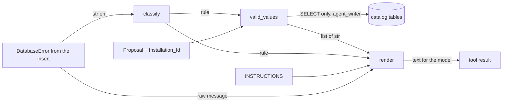

# Design Document

## Overview

This design covers `opsmem/errors.py`, the module that turns a database rejection of a configuration row into the text the model reads, and the README step that shows both modes with real output.

The module has three pure parts and one part that reads the database:

- `INSTRUCTIONS`: the table of 14 instruction templates. It is an external contract, so every string is kept byte for byte as written in the requirements.
- `classify(message)`: reads the rule name out of a database message.
- `render(rule, valid, mode, raw_message)`: builds the text for `raw` or `instructive` mode.
- `valid_values(db, rule, proposal, installation_id)`: the Valid_Values_Lookup. It reads the values from the catalog tables with plain SELECT statements.

Key design decisions:

- The classifier, the renderer and the table are pure functions of their arguments. They need no database and no network (Requirement 5.1).
- The lookup is the only part that touches the Database_Object. It receives that object as an argument. It does not call `connect`, so tests can pass a stand-in.
- The lookup is a table: rule name to one SQL text, the Proposal keys it binds, and a function that turns rows into strings. A rule that is not in the table sends no statement (Requirement 4.13).
- The module does not catch anything except `DatabaseError` in the lookup (Requirement 4.15). `ConfigError`, `ConnectionFailed` and programming errors propagate.
- No tool name appears in the module. The instructions name the parameter to change, never a tool. The reason is in the README step: a tool name in a rejection tells the model which action to retry, and the experiment compares what the model learns from the rule alone.

Out of scope, as in the requirements: the agent, the escalation after repeated rejections and the experiment. The tool layer that calls `classify`, `valid_values` and `render` in order is a later spec. This design only fixes the signatures it will use.

### What I verified in the existing code

I read `sql/schema.sql`, `opsmem/db.py` and the catalog-schema design before choosing the signature and the queries.

| Fact | Where | Consequence |
|---|---|---|
| Catalog tables are `installations`, `services`, `source_fields`, `signal_requests`, `allowed_units` | `sql/schema.sql` | Query targets below use exactly these names |
| `signal_requests` columns: `installation_id`, `request_id`, `service_id`, `signal_type`, `sample_s`, `request_text` | `sql/schema.sql` | Queries 4.4 to 4.7 |
| `source_fields` columns: `installation_id`, `service_id`, `field_name`, `unit`, `min_sample_s`, `max_sample_s` | `sql/schema.sql` | Queries 4.8 to 4.12. The column is `field_name`, while `collection_configs` calls it `source_field` |
| `allowed_units` columns: `signal_type`, `unit`. No `installation_id` | `sql/schema.sql` | Requirement 4.2 applies only to tables with `installation_id`, so this query has no installation filter (see Open points) |
| `GRANT SELECT ON installations, services, source_fields, signal_requests, allowed_units, signals TO agent_writer` | `sql/schema.sql` | The lookup works with the `agent_writer` Database_Object. This is the role of the agent, so the tool layer already holds it |
| `approver` has SELECT only on `collection_configs` and INSERT, SELECT on `review_log` | `sql/schema.sql` | The lookup must not be given an `approver` object. Every query would fail with a permission error and Requirement 4.15 would hide it as `none listed` |
| `run(sql, **params) -> list[list]`, `:name` parameters, `DatabaseError` as an attribute of the object | `opsmem/db.py` | The lookup uses `db.run(...)` and `except db.DatabaseError` |
| `to_field` raises `TypeError` for types other than None, bool, int, float, str | `opsmem/db.py` | The lookup passes only `str` values and skips the query when a Proposal value is not a `str` |
| Local backend uses `autocommit=True`, and Aurora sends one statement per call | `opsmem/db.py` | A failed insert leaves no aborted transaction, so a SELECT right after the rejection works on the same object |
| Row cells come back as `int` for `integer` columns on both backends | `opsmem/db.py` (`from_field`, psycopg) | The lookup converts every cell with `str()` (Requirement 4.3) |

## Architecture



Call order in the tool layer, for reference:

1. `rule = classify(str(err))`
2. In `instructive` mode: `valid = valid_values(db, rule, proposal, installation_id)`. In `raw` mode: `valid = []`, no lookup.
3. `text = render(rule, valid, mode, str(err))`

Step 2 is the caller's job because Requirement 4.1 asks for the lookup only in instructive mode. `render` stays pure.

## Components and Interfaces

### Module layout

```python
# opsmem/errors.py
from __future__ import annotations

import re
from collections.abc import Mapping, Sequence

MODES = ("raw", "instructive")
MAX_VALID = 10
NONE_LISTED = "none listed"
UNKNOWN = "unknown"
UNKNOWN_INSTRUCTION = "Rejected."

INSTRUCTIONS: dict[str, str] = {...}          # 14 entries, see below

def classify(message: str) -> str: ...
def render(rule: str, valid: Sequence[str], mode: str, raw_message: str) -> str: ...
def valid_values(db, rule: str, proposal: Mapping[str, object], installation_id: str) -> list[str]: ...
```

The module imports nothing from `opsmem.db`. The lookup gets `DatabaseError` from the object it receives (`db.DatabaseError`), the same way the interface of the catalog-schema spec defines it.

### Instruction_Table

The 14 keys and values are copied from Requirement 1.2 to 1.15. They are shown here in the order of Requirement 1.1 for the reader. A test compares each value to a literal in the test file, so a change in one place fails the test.

```python
INSTRUCTIONS = {
    "config_field_exists": "Unknown source_field. Valid source_field: {valid}.",
    "config_unit_matches_source": "Wrong unit for this source_field. Valid unit: {valid}.",
    "config_answers_request": "Unknown request_id. Valid request_id: {valid}.",
    "config_service_matches_request": "Wrong service_id for this request. Valid service_id: {valid}.",
    "config_field_in_service": "This source_field is not in this service. Valid source_field: {valid}.",
    "config_type_matches_request": "Wrong signal_type for this request. Valid signal_type: {valid}.",
    "config_sampling_requested": "Wrong sample_seconds for this request. Valid sample_seconds: {valid}.",
    "config_one_per_request": "This request_id is already configured.",
    "config_unit_allowed_for_type": "This unit is not allowed for this signal_type. Valid unit: {valid}.",
    "config_sampling_supported": "sample_seconds not supported by this source_field. Valid range: {valid}.",
    "config_one_per_signal": "This signal_name is already used. Choose another signal_name.",
    "config_one_per_field": "This source_field is already configured.",
    "signal_name_check": "signal_name must be lowercase letters, digits and underscores, 3 to 41 characters.",
    "integer_input": "sample_seconds must be a whole number of seconds.",
}
```

Notes:

- Templates with `{valid}` are the 8 rules that have a lookup. The other 6 have no placeholder and no lookup (Requirement 4.13 lists exactly those 6 plus `unknown`).
- The instruction says `sample_seconds`, while the database column is `sample_s`. This is the contract text of the requirements and it is kept. It is the name of the tool parameter the model sees, so the model changes the right argument.
- `signal_name_check` says "3 to 41 characters". This agrees with the CHECK pattern `^[a-z][a-z0-9_]{2,40}$` of the schema: 1 + 2 to 1 + 40.
- No value contains a tool name or `propose_config` (Requirements 1.16, 1.17).

### `render`

```python
def render(rule, valid, mode, raw_message):
    if mode == "raw":
        return "ERROR: " + raw_message
    if mode == "instructive":
        return f"REJECTED ({rule}). Not saved. " + _instruction(rule, valid)
    raise ValueError(f"Invalid mode: {mode!r}")

def _instruction(rule, valid):
    template = INSTRUCTIONS.get(rule)
    if template is None:
        return UNKNOWN_INSTRUCTION
    shown = ", ".join(str(v) for v in valid[:MAX_VALID]) or NONE_LISTED
    return template.replace("{valid}", shown)
```

Behaviour, in terms of the requirements:

- Raw mode concatenates `"ERROR: "` and `raw_message` and nothing else. The message is not stripped, decoded or shortened (2.1). `rule` and `valid` are ignored.
- Instructive mode puts the value of `rule` in the prefix as given, also when the rule is unknown (2.2, 2.5, and test 5.12).
- `str.replace` is used instead of `str.format`. Valid values such as `{x}` or `%s` cannot break the template, and every `{valid}` is replaced in one pass (2.3). A value that itself contains `{valid}` is not expanded again.
- A template without `{valid}` goes through `replace` unchanged (2.4). The `none listed` computation is harmless for it.
- `valid[:10]` keeps the given order and takes the first 10 (2.6, 2.7). An empty sequence gives `none listed` (2.8).
- The mode is checked by equality. Anything else, including `None`, `"RAW"` or `""`, raises `ValueError` with the value in the message through `!r` (2.9). The check happens before any other work, so `render(rule, valid, "RAW", msg)` never returns text.
- The Instruction contains only table text and values from `valid`. Tool names live outside the module, so (2.10) holds as long as the caller does not pass a tool name as a valid value. The lookup returns values from the catalog only.

### `classify`

Rules are read in the fixed order of Requirement 3. The implementation is one regular expression for the names and three small checks.

```python
_NAME = re.compile(
    r'constraint "([^"]+)"'          # PostgreSQL / psycopg text
    r"|CONSTRAINT: ([A-Za-z0-9_]+)"  # DETAIL-style text
    r"|CONSTRAINT=([A-Za-z0-9_]+)"   # key=value style text
    r"|\b(config_[A-Za-z0-9_]*)"     # bare word, as in the sampling trigger message
)
_SQLSTATE = re.compile(r"SQLState: ([0-9A-Z]{5})")

def classify(message):
    for m in _NAME.finditer(message):
        name = next(g for g in m.groups() if g is not None)
        if name in INSTRUCTIONS:
            return name
        if name.endswith("signal_name_check"):
            return "signal_name_check"
    codes = _SQLSTATE.findall(message)
    if "22P02" in codes or "invalid input syntax for type integer" in message:
        return "integer_input"
    if "signal_name" in message and "check" in message.lower():
        return "signal_name_check"
    return UNKNOWN
```

Why this satisfies the requirements:

- `finditer` yields matches left to right, so "order of appearance" (3.1) is the order of the match start positions. The first name that qualifies wins (3.2). A name qualifies when it is a key of the table, or when it ends with `signal_name_check` (3.3). That is how `collection_configs_signal_name_check` becomes `signal_name_check` (3.10).
- The alternatives are tried in the order written at each position. `constraint "config_field_exists"` is consumed by the first alternative, so the bare-word alternative does not match the same text a second time. This does not change the result, only avoids a duplicate.
- `\bconfig_` requires a word boundary. `collection_configs_...` does not contain `config_` at a boundary, so it is never read as a bare word. It is still read through the `constraint "..."` alternative.
- The sampling trigger message `config_sampling_supported: sample_s 5 outside 10 to 300 for api_p95` starts with the bare word, so the first name is `config_sampling_supported` (3.8, test 5.3). On Aurora the Data API text may add a prefix, and the name is still found as a bare word.
- A foreign key violation names the constraint in `violates foreign key constraint "config_field_exists"` (3.9, test 5.2).
- The two fallbacks run only if no name qualified (3.4, 3.5, 3.11). The `SQLState: ` marker is the Data API form (test 5.6). The text `invalid input syntax for type integer` is the PostgreSQL form (test 5.4). A message with the marker `22P02` and no constraint name returns `integer_input` (3.11).
- The `signal_name` and `check` fallback is the last check before `unknown` (3.6, 3.7). `check` is matched as a case-insensitive substring (`"check" in message.lower()`), not as a separate word. It therefore also matches inside a longer name such as `collection_configs_signal_name_check`. The suffix rule in the first step handles that name earlier when it is collected as a constraint name; the substring test covers the same name when it appears without a constraint marker.
- The return value is always a table key or `unknown` (3.12), because the only literals returned are `integer_input`, `signal_name_check`, a key found in the table, and `UNKNOWN`.
- The function never raises for a `str`. For non-`str` input it raises `TypeError` from `re`, which is a programming error.

One residual risk is a catalog value that looks like a rule name, for example a field called `config_field_exists` shown in a `Key (...)=(...)` detail line. The constraint name comes earlier in the message, so it wins. The Database messages checked in the catalog-schema spec put the constraint name before any DETAIL line.

### Valid_Values_Lookup

Signature:

```python
def valid_values(db, rule: str, proposal: Mapping[str, object], installation_id: str) -> list[str]:
```

- `db`: a Database_Object connected as `agent_writer`. Any object with `run(sql, **params)` and `DatabaseError` works.
- `rule`: the output of `classify`.
- `proposal`: a mapping with the keys `request_id`, `service_id`, `signal_type`, `source_field` and `sample_s`. Only the first four are used by queries. Extra keys are ignored. A missing key, or a value that is not a `str`, is treated as a name the database does not hold (4.14): the query is skipped and `[]` is returned. This keeps a `None` or an `int` from reaching `to_field`.
- `installation_id`: the Installation_Id of the run, passed in by the caller. The module does not read the environment or a global.
- Returns a `list[str]`. Lists of names are sorted with Python `sorted` on the strings, so the order does not depend on the collation of the database and is the same on both backends (4.4, 4.8, 4.9, 4.11). Single-value results have one element. An empty list means "nothing to show".

Queries. All use `:name` parameters, no casts and no `%`, so they pass through the `db.py` scanner and the Data API unchanged. Each one is a plain `SELECT`.

| Rule | SQL | Bound from | Result |
|---|---|---|---|
| `config_answers_request` | `SELECT request_id FROM signal_requests WHERE installation_id = :installation_id` | installation | all, sorted |
| `config_service_matches_request` | `SELECT service_id FROM signal_requests WHERE installation_id = :installation_id AND request_id = :request_id` | `request_id` | the one value |
| `config_type_matches_request` | `SELECT signal_type FROM signal_requests WHERE installation_id = :installation_id AND request_id = :request_id` | `request_id` | the one value |
| `config_sampling_requested` | `SELECT sample_s FROM signal_requests WHERE installation_id = :installation_id AND request_id = :request_id` | `request_id` | `str(int)` |
| `config_field_in_service` | `SELECT field_name FROM source_fields WHERE installation_id = :installation_id AND service_id = :service_id` | `service_id` | all, sorted |
| `config_field_exists` | `SELECT field_name FROM source_fields WHERE installation_id = :installation_id` | installation | all, sorted |
| `config_unit_matches_source` | `SELECT unit FROM source_fields WHERE installation_id = :installation_id AND field_name = :source_field` | `source_field` | the one value |
| `config_unit_allowed_for_type` | `SELECT unit FROM allowed_units WHERE signal_type = :signal_type` | `signal_type` | all, sorted |
| `config_sampling_supported` | `SELECT min_sample_s, max_sample_s FROM source_fields WHERE installation_id = :installation_id AND field_name = :source_field` | `source_field` | `"<min> to <max> seconds"` |

Implementation shape:

```python
_LOOKUPS = {
    "config_answers_request": (
        "SELECT request_id FROM signal_requests WHERE installation_id = :installation_id",
        (), _sorted_first_column),
    "config_service_matches_request": (
        "SELECT service_id FROM signal_requests WHERE installation_id = :installation_id AND request_id = :request_id",
        ("request_id",), _first_column),
    # ... one entry per row of the table above ...
    "config_sampling_supported": (
        "SELECT min_sample_s, max_sample_s FROM source_fields "
        "WHERE installation_id = :installation_id AND field_name = :source_field",
        ("source_field",), _range_text),
}

def valid_values(db, rule, proposal, installation_id):
    entry = _LOOKUPS.get(rule)
    if entry is None:
        return []                                   # 4.13: no statement
    sql, keys, shape = entry
    params = {}
    for key in keys:
        value = proposal.get(key)
        if not isinstance(value, str):
            return []                               # 4.14: nothing to look up
        params[key] = value
    if "installation_id" in sql_params(sql):
        params["installation_id"] = installation_id
    try:
        rows = db.run(sql, **params)
    except db.DatabaseError:
        return []                                   # 4.15
    return shape(rows)
```

- `sql_params` is the `param_names` function of `opsmem.db`, or a literal flag in the table entry. A flag in the entry is simpler and keeps `errors.py` independent from `db.py` internals, so the table entry carries `uses_installation: bool`.
- `_first_column` returns `[str(row[0]) for row in rows]`. `_sorted_first_column` sorts that list. `_range_text` returns `[f"{rows[0][0]} to {rows[0][1]} seconds"]` or `[]` for no rows.
- Every `SELECT` is sent through one `db.run` call. No statement other than SELECT exists in the module (4.1).
- No row for the Proposal name gives an empty list (4.14), with no special code.
- `db.DatabaseError` is the class from the Database_Object (the catalog-schema interface). Both backends raise this one class, so the `except` works on Aurora and local.
- `installation_id` is required to be a `str`. A non-`str` would raise `TypeError` in the backend. That is a caller bug and is not hidden.

Row counts: `installation_id` plus `service_id`, `request_id` and `field_name` are keys of the tables (`signal_requests` PK `(installation_id, request_id)`, `source_fields` PK `(installation_id, field_name)`), so the single-value lookups return at most one row. `allowed_units` PK `(signal_type, unit)` makes unit lists free of duplicates.

## Data Models

The module owns no persistent data. Its inputs and outputs:

| Name | Type | Notes |
|---|---|---|
| Rule | `str` | A key of `INSTRUCTIONS`, or `"unknown"` |
| Mode | `str` | `"raw"` or `"instructive"` |
| Proposal | `Mapping[str, object]` | Keys `request_id`, `service_id`, `signal_type`, `source_field`, `sample_s`. Only `str` values are bound |
| Valid values | `list[str]` | Possibly more than 10. `render` shows the first 10 |
| Rendered text | `str` | `ERROR: <message>` or `REJECTED (<rule>). Not saved. <Instruction>` |

Output strings, written as templates:

```
raw:         ERROR: <raw_message>
instructive: REJECTED (<rule>). Not saved. <Instruction>
```

Example with the real catalog (values come from the database at run time):

```
REJECTED (config_field_exists). Not saved. Unknown source_field. Valid source_field: <up to 10 field names>.
```

## Error Handling

| Situation | Behaviour | Requirement |
|---|---|---|
| `mode` is not `raw` or `instructive` | `ValueError("Invalid mode: <repr>")` | 2.9 |
| `rule` is not a key of the table | Instruction is `Rejected.`, prefix keeps the given rule | 2.5 |
| `valid` is empty | `none listed` | 2.8 |
| `valid` has more than 10 values | first 10 shown, rest dropped silently | 2.7 |
| Message names no rule | `unknown`, so the model sees `REJECTED (unknown). Not saved. Rejected.` | 3.7 |
| Rule has no lookup | `[]`, no statement sent | 4.13 |
| Proposal lacks the name, or the value is not a `str` | `[]`, no statement sent | 4.14 |
| Database has no row for the name | `[]` | 4.14 |
| Lookup raises `db.DatabaseError` | `[]`, so the text shows `none listed` | 4.15 |
| Lookup raises anything else (`ConfigError`, `ConnectionFailed`, `TypeError`, throttling) | propagates | by design: only SQL errors are hidden |

A lookup that returns `[]` because of a permission error (wrong role) looks the same as "nothing to list". The role is a wiring matter of the tool layer. The README and the module docstring say the object must be the `agent_writer` one.

## Open points

1. Resolved: Requirement 4.2 and `allowed_units`. Requirement 4.2 now reads "every query on a table that has an `installation_id` column". The table `allowed_units` has no such column (`sql/schema.sql`), so `config_unit_allowed_for_type` reads the units by `signal_type` only. The set of allowed units is global to the schema, so no other installation's data can leak. The test for 4.2 covers the eight queries on installation tables.
2. Sorting. "Sorted" is read as Python string order. `R10` sorts before `R2`. The manual has `R1` to `R6`, so this has no effect on the real catalog.
3. `sample_s` of the Proposal is not used by any lookup. The rule `config_sampling_requested` shows the request's value, and `config_sampling_supported` shows the field's range, both without the proposed value.

## Correctness Properties

_A characteristic or behavior that should hold true across all valid executions of the system, stated formally. These statements bridge the human-readable requirements and machine-verifiable correctness guarantees._

Reflection on redundancy: the prework gave about 30 testable criteria. I merged them as follows:

- 2.2 to 2.5 are one structure property. 2.6 to 2.8 are one Valid_List property.
- 3.1 to 3.3 and 3.8 to 3.10 are one "message built around a rule name is classified as that rule" property. 3.2 (order) stays separate, because it checks a different relation.
- 3.4, 3.5 and 3.11 are one fallback property. 3.7 and 3.12 are one totality property.
- 4.1 to 4.3 and 4.13 share the same recording stand-in, but check different things (statement shape, installation scope, no-lookup rules), so they stay as three properties. 4.4 to 4.12 and 4.14 are one oracle property.
- 1.16 and 1.17 are subsumed by the render property for 2.10 and by the table test 5.10.

### Property 1: Raw mode returns the message unchanged

*For any* rule, any list of valid values and any raw message, `render(rule, valid, "raw", message)` equals `"ERROR: " + message`.

**Validates: Requirements 2.1**

### Property 2: Instructive output is the prefix plus the filled template

*For any* rule that is a key of the Instruction_Table and any list of valid values, the output of `render` in instructive mode starts with `REJECTED (<rule>). Not saved. `, contains no remaining `{valid}`, and, for a template without `{valid}`, ends with the template unchanged. *For any* rule that is not a key, the output equals `REJECTED (<rule>). Not saved. Rejected.`

**Validates: Requirements 2.2, 2.3, 2.4, 2.5**

### Property 3: The Valid_List holds the first 10 values in order

*For any* list of 0 to 30 values that do not contain the separator `, ` and any rule whose template has `{valid}`, the list shown in the Instruction equals the first `min(n, 10)` values in their given order joined with `, `, and equals `none listed` when the list is empty.

**Validates: Requirements 2.6, 2.7, 2.8**

### Property 4: An invalid mode is rejected with its value

*For any* string that is neither `raw` nor `instructive`, `render` raises an error whose message contains that string.

**Validates: Requirements 2.9**

### Property 5: Instructions never name a tool

*For any* rule, and any list of valid values that contain none of the tool names (a test-local list that includes `propose_config`), the instructive output contains none of those tool names after the prefix, and no value of the Instruction_Table contains one.

**Validates: Requirements 1.16, 1.17, 2.10**

### Property 6: Classification is total and stays inside the table

*For any* text, `classify` returns without raising, and the result is a key of the Instruction_Table or `unknown`. *For any* text built only from letters, digits, spaces and the characters `.,` the result is `unknown`.

**Validates: Requirements 3.7, 3.12**

### Property 7: A message built around a rule name is classified as that rule

*For any* rule that is a key of the Instruction_Table other than `integer_input`, any surrounding filler text that holds no rule name, and any of the message shapes (foreign key violation text with `constraint "<name>"`, unique violation text, check violation text, `CONSTRAINT: <name>`, `CONSTRAINT=<name>`, and the trigger shape `<name>: <filler>`), `classify` returns that rule. For the rule `signal_name_check` the name `collection_configs_signal_name_check` is used and the result is `signal_name_check`.

**Validates: Requirements 3.1, 3.2, 3.3, 3.8, 3.9, 3.10**

### Property 8: The first qualifying name wins

*For any* two different keys `a` and `b` of the Instruction_Table, a message that names `a` before `b` is classified as `a`, and the same message with the two names swapped is classified as `b`.

**Validates: Requirements 3.2**

### Property 9: Integer and signal-name fallbacks apply only without a constraint name

*For any* filler text that names no constraint, a message that carries the marker `SQLState: 22P02`, or the text `invalid input syntax for type integer`, is classified as `integer_input`. *For any* filler that names no constraint and carries neither integer marker, a message that contains `signal_name` and the text `check` in any letter case (as a substring, not a separate word) is classified as `signal_name_check`.

**Validates: Requirements 3.4, 3.5, 3.6, 3.11**

### Property 10: Lookups send SELECT statements only, scoped to the installation

*For any* rule, any Proposal and any installation, every statement the lookup sends starts with `SELECT`. Every statement on a table that has an `installation_id` column binds `installation_id` to the given Installation_Id, and no value of another installation appears in the result. *For any* Proposal, a rule without a lookup sends zero statements and returns `[]`.

**Validates: Requirements 4.1, 4.2, 4.13**

### Property 11: Lookup results match the catalog

*For any* catalog and any Proposal (names may be missing from the catalog), the lookup returns a list of `str` that equals the value computed by a plain Python oracle over the catalog rows: all request ids of the installation, the service id, signal type or sample seconds of the named request, the field names of the named service, all field names, the unit of the named field, the units allowed for the named signal type, or `<min> to <max> seconds` of the named field. Lists of names are sorted. A name the catalog does not hold gives `[]`.

**Validates: Requirements 4.3, 4.4, 4.5, 4.6, 4.7, 4.8, 4.9, 4.10, 4.11, 4.12, 4.14**

## Testing Strategy

Dual approach. Property tests cover the universal properties above. Example tests cover the concrete contract strings and the edge cases that the requirements name.

### Property-based tests

- Library: `hypothesis` (already in the dev group, `hypothesis==6.140.0`). No new dependency.
- At least 100 examples per property: `@settings(max_examples=100)` or higher. The default profile of `conftest.py` can set this once.
- Each test carries a tag comment: `# Feature: instructive-rejections, Property <n>: <text>`.
- File: `tests/test_errors_pure.py` for Properties 1 to 9, with no database and no network (Requirement 5.1). File `tests/test_errors_lookup.py` for Properties 10 and 11.

Generators:

- `rules = st.sampled_from(sorted(INSTRUCTIONS))` and `any_rule = st.one_of(rules, st.text())`.
- `valid_lists = st.lists(st.text(alphabet=string.ascii_letters + string.digits + "_-", min_size=1), max_size=30)`. The alphabet has no `, `, so Property 3 can split the shown list on `, `. It has no `{`, so a value cannot fake a placeholder.
- `filler = st.text(alphabet=string.ascii_letters + string.digits + " .,")`. It has no underscore, quote, colon or equals sign, so it cannot contain `config_`, `signal_name`, `constraint "..."` or `SQLState: `. Property 6 (the `unknown` half) and Property 9 rely on this. Filler may contain the letters `check` as a substring, which is harmless: the fallback also needs `signal_name`, which filler cannot produce.
- Message shapes for Property 7 are templates with a `{name}` hole and `filler` before and after, taken from the real shapes:
  - `insert or update on table "collection_configs" violates foreign key constraint "{name}"`
  - `duplicate key value violates unique constraint "{name}"`
  - `new row for relation "collection_configs" violates check constraint "{name}"`
  - `CONSTRAINT: {name}` and `CONSTRAINT={name}`
  - `{name}: sample_s 5 outside 10 to 300 for api_p95`
- Property 8 builds `"... constraint \"a\" ... constraint \"b\" ..."` from two distinct keys.
- Tool names for Property 5: a test-local tuple such as `("propose_config", "submit_config", "list_requests")`. The module itself holds no list of tools. The names are examples of the agent's tools and the real list belongs to the agent spec. `valid_lists` for this test filters out values that contain any of them.

Lookup stand-in for Properties 10 and 11:

- An in-memory `sqlite3` database with the tables `signal_requests`, `source_fields` and `allowed_units` and the same column names as `sql/schema.sql` (types are loose in SQLite). `sqlite3` uses `:name` parameters natively, so the real SQL text of the lookup runs unchanged. This keeps the test free of a PostgreSQL server and tests the actual query text, not a copy of it.
- A small wrapper class with `DatabaseError = db.DatabaseError`, `run(sql, **params)` that records `(sql, params)` like `tests/spy.py`, and wraps `sqlite3.Error` in `DatabaseError`. Extra parameters are dropped before the call because `sqlite3` rejects unused named parameters in some versions; the wrapper binds only the names the SQL uses, using `param_names` from `opsmem.db`.
- Catalog strategy: 1 to 3 installations, each with 0 to 6 services, 0 to 8 fields and 0 to 6 requests, built from a small name pool so that the Proposal often hits existing names and sometimes misses. `allowed_units` is drawn from a small pool of `(signal_type, unit)` pairs.
- The oracle is plain Python over the generated lists. It is written independently of the SQL (list comprehensions), so the property compares two implementations.
- A guard in Property 10: tables that have an `installation_id` column are read from `sql/schema.sql` text by a regular expression on the `CREATE TABLE` blocks, so the property follows the schema if it changes. `allowed_units` is the one table without it, and its query is outside the scope of Requirement 4.2, which covers only tables with an `installation_id` column.

### Example-based unit tests

These map to Requirement 5 and need no database:

- 5.2: a foreign key violation message that names `config_field_exists` gives `config_field_exists`.
- 5.3: `ERROR: config_sampling_supported: sample_s 5 outside 10 to 300 for api_p95` gives `config_sampling_supported`.
- 5.4: `ERROR: invalid input syntax for type integer: "every minute"` gives `integer_input`.
- 5.5: a check violation that names `collection_configs_signal_name_check` gives `signal_name_check`.
- 5.6: a Data API style message with `SQLState: 22P02` gives `integer_input`.
- 5.7: raw mode returns `ERROR: ` plus the unchanged message.
- 5.8: 12 valid values show exactly the first 10.
- 5.9: no valid values show `none listed`.
- 5.10: no value of the table contains `propose_config`.
- 5.11: a parametrized test with the 14 literal strings, and a check that the key set has exactly 14 members.
- 5.12: `render("not_a_rule", [], "instructive", "x")` equals `REJECTED (not_a_rule). Not saved. Rejected.`
- 4.15: a stand-in whose `run` raises `DatabaseError` gives `[]` for each rule with a lookup, and `render` then shows `none listed`.
- The `approver` note: a test is not needed. The role grants are covered by the catalog-schema tests.

### Integration test (one, not a property)

- `tests/test_errors_pg.py`, marked `local_pg` like `tests/test_rules_pg.py`. It connects as `agent_writer` to the local container with the schema and catalog applied, inserts a row with an unknown `source_field`, catches `DatabaseError`, and checks `classify(str(err)) == "config_field_exists"` and that `valid_values` returns the 9 field names of `install-07`, sorted. This is the only test that proves the query text runs on PostgreSQL with the real grants. It does not need Aurora; the Data API message shape is covered by the `SQLState: ` example tests.

### README step "Verify without spending"

Placement and rules follow Requirement 6: the step goes under `## Part 1: the database says no` as `### 3. Verify without spending`, added without changing existing text. Missing title, prerequisites or the `## Run it locally, paying only for the model` section are added. It is the last task before the final checkpoint.

How the real output is produced: the step shows a short script run with `uv run python` against the local database, and the two lines it prints. I run it once when the task executes and paste the output unedited.

```python
from opsmem import db, errors

agent = db.connect("agent_writer")
proposal = {"request_id": "R1", "service_id": "api", "signal_type": "latency",
            "source_field": "no_such_field", "sample_s": 60}
try:
    agent.run(
        "INSERT INTO collection_configs (run_id, installation_id, request_id, service_id, signal_name,"
        " signal_type, source_field, unit, sample_s, model_id)"
        " VALUES ('demo', 'install-07', :request_id, :service_id, 'demo_signal', :signal_type,"
        " :source_field, 'ms', :sample_s, 'demo')", **proposal)
except agent.DatabaseError as err:
    rule = errors.classify(str(err))
    valid = errors.valid_values(agent, rule, proposal, "install-07")
    print(errors.render(rule, [], "raw", str(err)))
    print(errors.render(rule, valid, "instructive", str(err)))
```

The sampling trigger returns the row unchanged for a field it does not find, so the unknown field is reported by `config_field_exists`, the first foreign key. If the text of the real output differs from this expectation, the README shows what the code printed. The step is written in the first person, explains that the Instruction names the parameter to change and never a tool, and gives the reason: a tool name tells the model which action to repeat, and the experiment wants to measure what the model learns from the rule and the valid values alone. It describes only what the code does (Requirement 6.8).
