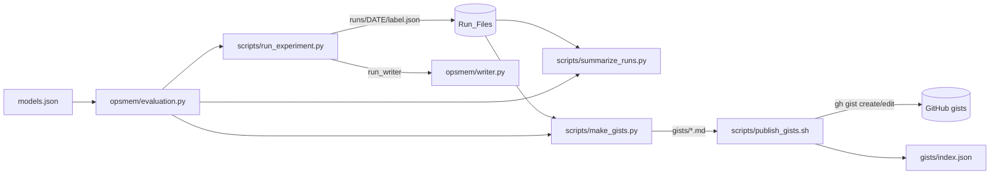
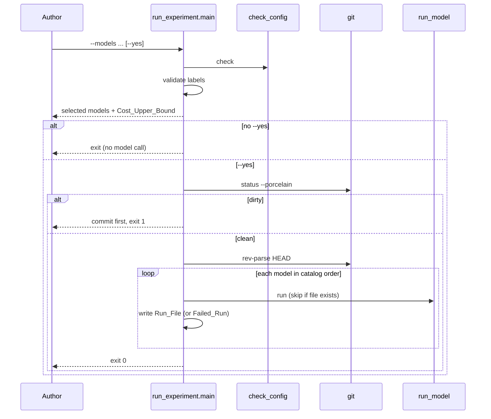

# Design Document

## Overview

This feature runs the writer agent on five Bedrock models, measures each run, and turns the run files into public gists. The work splits into a pure core and thin scripts:

- `opsmem/evaluation.py` holds all logic that has inputs and outputs: catalog loading, cost, trace classification, table rendering, gist rendering, dirty-tree detection. It does no I/O except reading JSON files given a path.
- `scripts/run_experiment.py`, `scripts/summarize_runs.py` and `scripts/make_gists.py` are thin `main(argv, ...)` functions in the style of `scripts/run_writer.py`. Every outside dependency (model runner, git, clock, config check, streams) is a keyword argument with a real default, so tests inject fakes and need no AWS and no model.
- `scripts/publish_gists.sh` is the only outward action. It wraps `gh` and is run by the author.

The agent input comes from `opsmem.manual.agent_input(root, "install-07")` and the system prompt from `opsmem.writer.SYSTEM_PROMPT`. The region is read from `AWS_REGION` (value `us-east-1`) by the existing `build_agent`; this feature never hard-codes it except as text in the gist setup line.

Code examples use Python, the language of the repository.

## Architecture



Execution flow of the Experiment_Runner:



## Components and Interfaces

### models.json

A JSON list of five Model_Entry objects in the order required by Requirement 1. Fields: `label`, `name`, `model_id`, `input_usd_per_million`, `output_usd_per_million`, `price_source`. Prices are stored as JSON numbers and read with `Decimal(str(value))` so cost arithmetic is exact.

### opsmem/evaluation.py (pure core)

```python
PRICE_NOTE = ("US cross-region inference profiles can be billed slightly higher than the list price.")
MAX_TOOL_CALLS = 40                  # same limit as the writer
TOKENS_IN_PER_CALL = 4_000           # named constants for the Cost_Upper_Bound; documented in code
TOKENS_OUT_PER_CALL = 400
FULL_SAVE = 6
CLOSING_LINE = "Companion to the article *Predictability, not eloquence* on AWS Builder Center."

@dataclass(frozen=True)
class ModelEntry:
    label: str; name: str; model_id: str
    input_usd_per_million: Decimal; output_usd_per_million: Decimal; price_source: str

def load_catalog(path: Path) -> list[ModelEntry]: ...
def cost_usd(input_tokens: int, output_tokens: int, entry: ModelEntry) -> Decimal: ...   # unrounded
def format_cost(value: Decimal) -> str: ...                  # "$0.0022", ROUND_HALF_UP, 4 decimals
def cost_upper_bound(entries: list[ModelEntry]) -> Decimal: ...
def is_dirty(porcelain: str) -> bool: ...                    # any non-empty line not starting "?? "

def is_failed(run: dict) -> bool: ...                        # run has "error" and no "trace"
def count_saved(trace) -> int: ...                           # result startswith "Saved as draft"
def count_rejections(trace) -> int: ...                      # result startswith "REJECTED"
def ended_stopped(trace) -> bool: ...                        # last entry result startswith "STOPPED"
def saved_rows(trace) -> list[tuple]: ...                    # (request, service, field, type, unit, sampling) from call args
def load_runs(directory: Path) -> list[dict]: ...            # sorted by file name; adds "_label" from the file stem
def row_for(run: dict, entry: ModelEntry) -> list[str]: ...
def render_table(runs, catalog) -> str: ...                  # Results_Table + PRICE_NOTE below
def identical_rows_statement(runs) -> str: ...
def render_gists(runs, catalog, agent_input_text, system_prompt, date) -> dict[str, str]: ...
```

`is_dirty` implements the Dirty_Tree rule: `git status --porcelain` marks untracked files with `?? `, so a tree is dirty when at least one non-empty line does not start with `?? `.

`saved_rows` reads the call arguments of each Saved_Entry (`call` in the trace entry, as produced by `RunContext.trace`: `{"ts", "call", "result", "db_message"}`) and maps the call fields to the six columns. Rows are sorted by request before comparison so the identical-rows statement does not depend on call order.

The Cost_Upper_Bound is `sum(40 * (TOKENS_IN_PER_CALL * in_price + TOKENS_OUT_PER_CALL * out_price) / 1e6)` over the selected entries.

### scripts/run_experiment.py

```python
def main(argv=None, *, run_model=None, git=None, now=None, check_config=None,
         catalog_path=None, root=None, stdout=None, stderr=None) -> int: ...
```

Defaults: `run_model` builds a `RunContext` and calls `run_writer` (the same pair `run_writer.py` uses), `git` runs the real `git` command and returns stdout (raising `GitError` on a non-zero exit), `now` returns the current UTC datetime, `check_config` is `db.check_config` with `REQUIRED`, streams are `sys.stdout` and `sys.stderr`.

`run_model(entry, task, run_id) -> dict` is the single seam for the model: a fake returns a result dict or raises.

Order of steps in `main`:

1. Parse arguments (`--models`, `--out`, `--yes`).
2. `check_config(REQUIRED)`; a `SystemExit` propagates (nothing called yet).
3. Resolve labels against the catalog; unknown label prints it and returns 2.
4. Print selected models and the Cost_Upper_Bound with `PRICE_NOTE`.
5. Without `--yes`, return 0 after printing the estimate (no git call, no model call). The exit code here is 0 because the dry run is a valid outcome; the requirement only demands no model call.
6. `git status --porcelain`; if `is_dirty`, print "Uncommitted changes: commit first" and return 1.
7. `git rev-parse HEAD` gives the Commit. A `GitError` in step 6 or 7 prints the error and returns 1.
8. For each entry in catalog order: if `<out>/<label>.json` exists, print its name and skip; else call `run_model`, merge metadata, write the file. An exception from `run_model` writes a Failed_Run and continues.
9. Return 0.

### scripts/summarize_runs.py

```python
def main(argv=None, *, catalog_path=None, stdout=None, stderr=None) -> int: ...
```

Arguments: a Run_Directory and optional `--rows`. Prints `render_table`, then with `--rows` the saved rows of each Full_Save_Model and `identical_rows_statement`. An empty directory prints an error to `stderr` and returns 1.

### scripts/make_gists.py

```python
def main(argv=None, *, catalog_path=None, root=None, gists_dir=None, stdout=None, stderr=None) -> int: ...
```

Arguments: a Run_Directory. It reads `agent_input(root)` and `SYSTEM_PROMPT`, checks that all Run_Files hold the same `commit` (otherwise prints the commits and returns 1 before writing), then writes the files returned by `render_gists`. No clock is used: the date in the setup line is the UTC date of the earliest `started_at` in the Run_Files, so output is deterministic.

### scripts/publish_gists.sh

A bash script. For each `gists/*.md` it reads the URL from `gists/index.json`: no URL runs `gh gist create --public <file>` and records the printed URL; a URL runs `gh gist edit <id> <file>`. At the end it writes `gists/index.json`. `set -euo pipefail` makes a failed `gh` stop the script with a non-zero code and the error on stderr. The tasks never run it (Requirement 8.7).

### README Evidence section

An `## Evidence` section with one line per gist (title and link) and one line on regeneration with `summarize_runs.py` and `make_gists.py`. Links are filled in by the author after publishing.

## Data Models

Run_File (success):

```json
{
  "model_id": "us.amazon.nova-micro-v1:0",
  "label": "nova-micro",
  "mode": "instructive",
  "commit": "<git rev-parse HEAD>",
  "started_at": "2025-01-31T09:15:42Z",
  "tool_calls": 9, "rejections": {}, "follow_ups": 0, "escalated": null, "flagged": [],
  "trace": [{"ts": "...", "call": {}, "result": "Saved as draft ...", "db_message": null}],
  "input_tokens": 51844, "output_tokens": 2454, "final_text": "..."
}
```

All keys after `started_at` are the unmodified result of `run_writer`.

Failed_Run:

```json
{"model_id": "...", "label": "...", "mode": "instructive", "commit": "...", "started_at": "...", "error": "<error text>"}
```

`is_failed` is true when `error` is present and `trace` is absent.

Results_Table row: `Model | Saved | Tool calls | Rejections | Tokens in / out | Cost | Escalated`.

- Saved: `N of 6`.
- Cost: `format_cost(cost_usd(...))`, `$0.0000` for a Failed_Run.
- Escalated: `yes` or `no` from `ended_stopped`; for a Failed_Run the error text.
- Tokens: `51,844 / 2,454` with thousands separators. A Failed_Run shows `0 / 0` and 0 tool calls.

Sort key: `(-cost, label)` using the unrounded cost, so ordering is not changed by rounding ties.

Gist_Index: `{"<gist file name>": "<gist url>"}`.

Gist files:

- `agent-learns-from-rejections.md`: cheapest Full_Save_Model (ties broken by label), chosen from the Run_Files and catalog prices. Title with the model name, two sentences, setup line, agent input and system prompt in text blocks, one raw JSON line per trace entry (`json.dumps(entry, sort_keys=False)` of the stored entry), the summary line in the format of `run_writer.py`, and the saved rows.
- `five-models.md`: same header, Results_Table with price note, rows kept by each Finished_Model, identical-rows statement.
- `small-models-fail-safe.md`: written only when a Finished_Model has fewer than 6 Saved_Entries; per such model the raw Trace, the `escalated` text and the number of rows kept counted from the Trace.

Every file ends with `CLOSING_LINE`.

## Error Handling

| Situation | Behavior |
|---|---|
| Missing configuration | `db.check_config` prints names and raises `SystemExit(1)`; no model call |
| Unknown label | Print label, return 2, no model call |
| No `--yes` | Print estimate, return 0, no git, no model call |
| Dirty_Tree with `--yes` | Print "commit first", return 1 |
| Git command fails | Print error, return 1, no model call |
| Run_File exists | File untouched, message names it, model skipped |
| Model fails to start | Failed_Run with error text and commit written, next model runs |
| Empty Run_Directory | Summarizer prints error, returns 1 |
| Mixed commits | Gist_Generator prints the commits, returns 1, writes nothing |
| No Full_Save_Model | Skip `agent-learns-from-rejections.md`, print its name |
| `gh` fails | Publisher prints error, exits non-zero |

Writing a Run_File uses exclusive creation (`open(path, "x")`) so an existing file is never overwritten even if it appears after the existence check.

## Correctness Properties

*A property is a characteristic or behavior that should hold true across all valid executions of a system-essentially, a formal statement about what the system should do. Properties serve as the bridge between human-readable specifications and machine-verifiable correctness guarantees.*

Reflection: the per-column properties 5.3 to 5.8 are merged into one row property; 5.2 ordering, 5.5 cost and 5.9/5.10 rows stay separate because they test different functions. 3.2 and 3.3 merge into one dirty-tree property. 1.7 and 5.14 merge into the price note property. 7.8, 7.9 and 9.10 merge into one conditional-file property.

### Property 1: Price note accompanies every cost output

For any set of Run_Files and catalog, the output of `render_table`, the `five-models.md` gist and the runner estimate contain the price note, and in `render_table` it appears below the last table row.

**Validates: Requirements 1.7, 5.14**

### Property 2: Unknown labels block the run

For any `--models` value that contains a label not in the Model_Catalog, `run_experiment.main` returns a non-zero code, prints the unknown label, and calls no model.

**Validates: Requirements 2.6**

### Property 3: Cost upper bound formula

For any subset of Model_Entries, `cost_upper_bound` equals the sum over the subset of 40 times the per-call token budget priced at that entry's prices, and it is printed before any model call.

**Validates: Requirements 2.7, 2.8**

### Property 4: No model call without --yes

For any valid selection of models and any git fake, running without `--yes` calls no model and does not call git.

**Validates: Requirements 2.9, 3.4**

### Property 5: Dirty tree detection

For any `git status --porcelain` output, `is_dirty` is true if and only if at least one line does not start with `?? `; with `--yes`, a dirty output makes the runner return non-zero, print a message to commit first and call no model, while an output of only untracked lines lets the experiment proceed.

**Validates: Requirements 3.2, 3.3**

### Property 6: Commit in every Run_File

For any assignment of success or failure to the selected models and any commit string, every Run_File written, including each Failed_Run, holds `commit` equal to the value read from git.

**Validates: Requirements 3.6, 4.3**

### Property 7: Run_File content

For any result returned by a fake `run_model`, the saved `<out>/<label>.json` contains every key and value of that result, plus `model_id`, `label`, `mode`, `commit` and `started_at`.

**Validates: Requirements 4.2, 4.3**

### Property 8: Existing files are never overwritten

For any pre-existing contents of `<out>/<label>.json`, running the experiment leaves those bytes unchanged and does not call `run_model` for that label.

**Validates: Requirements 4.4**

### Property 9: Failed start is recorded and the run continues

For any subset of models whose `run_model` raises, every selected label has a Run_File, the failing ones are Failed_Runs holding the error text, all the others were run, and the exit code is 0.

**Validates: Requirements 4.5, 4.6**

### Property 10: Table row contents

For any Run_File and its Model_Entry, `row_for` gives Model equal to the entry name; Saved equal to `N of 6` with N the count of `Saved as draft` entries; Rejections equal to the count of `REJECTED` entries, never counting `STOPPED` ones; Tokens and Tool calls equal to the stored numbers; Escalated true if and only if the last trace entry starts with `STOPPED`; and for a Failed_Run `0 of 6`, `$0.0000` and the error text in Escalated.

**Validates: Requirements 5.3, 5.4, 5.6, 5.7, 5.8**

### Property 11: Cost formula and rounding

For any non-negative token counts and prices, `format_cost(cost_usd(...))` equals `(in * pin + out * pout) / 1,000,000` rounded half up to 4 decimals with a `$` prefix.

**Validates: Requirements 5.5**

### Property 12: Row ordering

For any set of Run_Files, the rows of the Results_Table are sorted by cost descending and, for equal costs, by label ascending, and there is one row per Run_File.

**Validates: Requirements 5.1, 5.2**

### Property 13: Identical rows statement

For any set of Full_Save_Models, `identical_rows_statement` reports identical rows if and only if the sorted saved rows of all of them are equal.

**Validates: Requirements 5.9, 5.10**

### Property 14: Deterministic output

For any set of Run_Files, rendering the table twice and generating the gists twice give byte-identical output.

**Validates: Requirements 5.11, 7.4, 9.1**

### Property 15: Gist model selection comes from the data

For any set of Run_Files with at least one Full_Save_Model, the title of `agent-learns-from-rejections.md` holds the name of the cheapest Full_Save_Model, whatever the labels and prices are.

**Validates: Requirements 7.3, 7.5**

### Property 16: Raw trace round trip

For any Run_File, the raw trace lines in a gist parse with `json.loads` back to the entries of the stored trace, in order.

**Validates: Requirements 7.5, 7.8**

### Property 17: Fail-safe gist is conditional

For any set of Run_Files, `small-models-fail-safe.md` is generated if and only if some Finished_Model has fewer than 6 Saved_Entries; each such model shows the rows kept counted from its Trace.

**Validates: Requirements 7.8, 7.9, 9.10**

### Property 18: Gist framing

For any generated Gist_File, the last line is the closing line, and every gist with a setup line holds the Commit read from the Run_Files.

**Validates: Requirements 7.6, 7.10, 9.9**

### Property 19: Mixed commits block generation

For any set of Run_Files with at least two different commits, `make_gists.main` returns non-zero, prints the commits, and writes no Gist_File.

**Validates: Requirements 7.11**

## Testing Strategy

Dual approach. Property tests use Hypothesis (already in the repository, see `.hypothesis/`), with at least 100 examples per property, each tagged `Feature: model-evaluation, Property N: <title>`. Unit tests cover examples and edge cases. The tests follow `tests/test_writer_script.py`: `load_script("run_experiment")` from `tests/helpers.py`, injected fakes for `run_model`, `git`, `now`, `check_config`, and `capsys` or injected streams. Nothing touches AWS, Docker or the network.

Test files:

- `tests/test_evaluation_core.py`: Properties 1, 10 to 13, and the cost, dirty-tree and catalog helpers.
- `tests/test_run_experiment.py`: Properties 2 to 9, plus examples for the order of events (estimate, git status, commit read, models), config failure, git failure, default `--out`, and model order and arguments.
- `tests/test_summarize_runs.py`: fixtures in `tests/fixtures/runs/` (one model saving 6 of 6 after rejections, one stopped by escalation, one Failed_Run), a check of every column, `$0.0022` for 51,844 and 2,454 at 0.035/0.14, a Stopped_Reply not counted as rejection, row order, the identical-rows statement, and the empty-directory error.
- `tests/test_make_gists.py`: Properties 14 to 19, the skip message when no Full_Save_Model exists, and the file list.
- `tests/test_publish_gists.py`: integration examples with a fake `gh` script first on `PATH` (create when no URL, edit when a URL exists, index written, failure exits non-zero). The real `gh` is never called.
- Smoke tests: `models.json` equals the table in Requirement 1; README contains the Evidence section lines.

Not property tested: the catalog data, README text, `publish_gists.sh` and the workflow rules of Requirement 10. Those are smoke or integration checks, or process rules encoded in `tasks.md`.

## Execution-Time Rules

These come from Requirement 10 and apply when the tasks run:

- After each task passes its tests, commit and push only that task as `feat(model-evaluation): <task number> <task title in lowercase>`, then show `git log --oneline -3`, stop and wait for the author. The message ends with a blank line and the trailer `Co-Authored-By: Kiro`, no email.
- When the author approves `tasks.md`, commit the three spec documents as `docs(model-evaluation): requirements, design and tasks` and push.
- Tasks never run `scripts/run_experiment.py --yes` or `scripts/publish_gists.sh`; they stop and ask the author, who runs them.
- The author reviews and commits the Run_Files under `runs/<date>/`.
- Because the runner refuses a Dirty_Tree, each task commit must land before the author runs the experiment.
