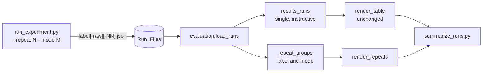
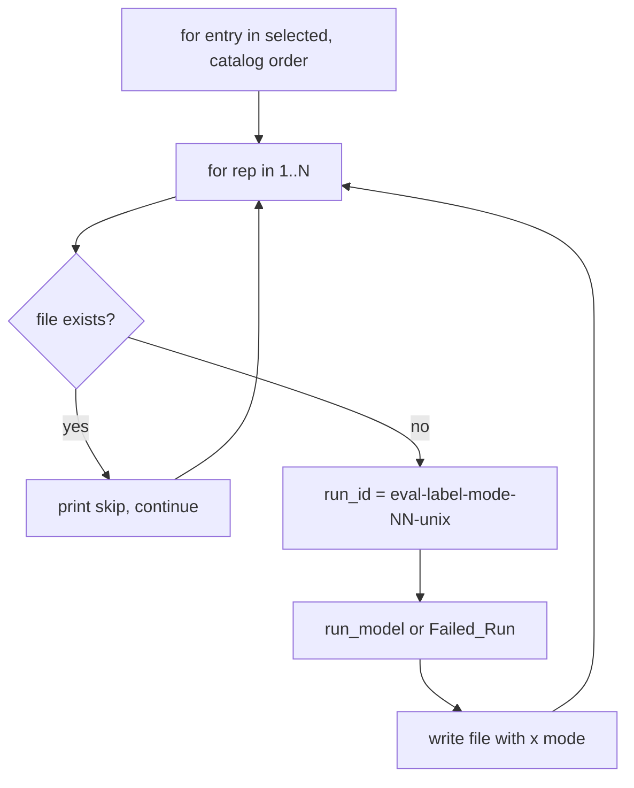

# Design Document

## Overview

This feature adds repeated runs and a choice of rejection mode to the evaluation of the `model-evaluation` spec. It keeps the same split: a pure core in `opsmem/evaluation.py` and thin `main(argv, ...)` scripts with injected dependencies.

- `scripts/run_experiment.py` gets `--repeat N` and `--mode raw|instructive`. It runs each model N times, names the files from the model label, the Mode and the repetition number, and records `repeat` and `repeat_count` in each Run_File when N is greater than 1.
- `scripts/summarize_runs.py` gets `--repeats`. Without it, the output on existing directories does not change. With it, the Summarizer prints the Repeats_Table and the Differing_Rows_Listing after the Results_Table.
- `opsmem/evaluation.py` gets the selection and grouping functions and the two renderers. All of them are pure.

`scripts/make_gists.py` changes by one line: it keeps only the Single_Runs with Mode `instructive`, so new runs never reach a gist. No change is made to `opsmem/writer.py`, `sql/schema.sql` or `models.json`. The writer already takes the Mode from `RunContext.mode`. The author keeps new runs in separate directories, and the selection protects the gists if a directory is mixed.

Code examples use Python, the language of the repository.

## Architecture



Loop of the Experiment_Runner after the checks of the `model-evaluation` spec:



## Components and Interfaces

### scripts/run_experiment.py

New constants and argument types:

```python
MODES = ("raw", "instructive")
MIN_REPEAT, MAX_REPEAT = 1, 20

def repeat_arg(text: str) -> int:
    """argparse type: a whole number from 1 to 20, else ArgumentTypeError naming the range."""
```

New arguments, added to `parse_args`:

```python
parser.add_argument("--repeat", type=repeat_arg, default=1, help="runs per model, 1 to 20")
parser.add_argument("--mode", choices=MODES, default="instructive", help="rejection mode of the runs")
```

`parse_args` runs before `check_config` and before any model call, so an invalid `--repeat` or `--mode` ends the process with the argparse error and exit code 2 and nothing else happens (Requirements 1.3, 2.3). The module constant `MODE` is removed. The mode comes from `args.mode`.

`real_run_model` takes the Mode as an extra argument, so it reaches `RunContext`:

```python
def real_run_model(entry, task: str, run_id: str, mode: str) -> dict:
    ctx = RunContext(run_id, INSTALLATION_ID, entry.model_id, mode, db.connect("agent_writer"))
    return run_writer(ctx, task)
```

The seam `run_model(entry, task, run_id, mode) -> dict` stays the single model dependency, so a fake can check the Mode (Requirement 8.9).

Pure helpers in `opsmem/evaluation.py`, used by the runner:

```python
def base_name(label: str, mode: str) -> str:            # "nova-micro" or "nova-micro-raw"
def run_file_name(label: str, mode: str, repeat: int, repeat_count: int) -> str:
    # repeat_count == 1: "<base>.json"; else "<base>-<repeat:02d>.json"
def make_run_id(label: str, mode: str, repeat: int, unix_seconds: int) -> str:
    # "eval-<label>-<mode>-<repeat:02d>-<unix_seconds>"
```

Order of steps in `main` (new or changed steps in bold):

1. Parse arguments. **`--repeat` and `--mode` are validated here.**
2. `check_config(REQUIRED)`.
3. Resolve labels.
4. Print the selected models and the Cost_Upper_Bound. **The bound is multiplied by the Repeat_Count. When the Repeat_Count is 1 the line is the same as before. When it is greater than 1 the line ends with `for N runs of each model` before the price note.**
5. Without `--yes`, return 0.
6. Git status, dirty check, commit.
7. **For each entry in catalog order and each repetition from 1 to N**, in that order:
   - Build the file name with `run_file_name`. If the file exists, print its name, skip, and go on with the next repetition.
   - Build `meta` with `model_id`, `label`, `mode`, `commit`, `started_at`, and `run_id = make_run_id(...)`. **When N is greater than 1, add `repeat` and `repeat_count` to `meta`.** `meta` is merged under the result of `run_model` as today and is also what a Failed_Run holds, so the fields reach the Failed_Run (Requirement 1.6).
   - Call `run_model(entry, task, run_id, args.mode)`. An exception writes a Failed_Run and the loop continues.
   - Write the file with exclusive creation as today.
8. Return 0.

The `run_id` is unique inside one command because it holds the label, the Mode and the repetition number, and two runs of one command never share all three. The shape is the same for every run, also with default arguments (`--repeat 1`, Mode `instructive`): that is the only difference from before this feature (Requirement 4.3). The Unix seconds stay at the end to make ids distinct across commands. A fake clock that returns one second for every run does not break uniqueness (Requirement 1.5).

### opsmem/evaluation.py: selection and grouping

```python
def is_repeated(run: dict) -> bool:      # "repeat" in run and "repeat_count" in run; never reads the file name
def run_mode(run: dict) -> str:          # run.get("mode", "instructive"): a Run_File without `mode` is instructive (5.2)
def results_runs(runs) -> list[dict]:    # Single_Runs with mode "instructive": the input of render_table
```

`load_runs` also stores the file name, as `_file`, next to `_label`. Both keys are only read, never written back.

```python
def repeat_groups(runs, catalog) -> list[tuple[ModelEntry, str, list[dict]]]:
    """Groups of runs by (label, mode), for the groups with a Repeated_Run or mode "raw".
    Each group holds every run of that label and mode, Single_Runs included, sorted by `_file`.
    Groups are ordered by catalog position, then "instructive" before "raw"."""
```

The label of a run is `run_label(run)`, which reads the `label` field first. A raw run keeps the plain label there (the `-raw` part is only in the file name), so `entry_for` finds its Model_Entry.

### scripts/make_gists.py

After `runs = evaluation.load_runs(args.run_dir)` the script sets `runs = evaluation.results_runs(runs)`. The rest is unchanged: the empty check, the commit check, the date and `render_gists` all work on the selected runs. When the directory has Run_Files but no selected run, the script prints `No run files in <dir>` as for an empty directory, and returns 1, so no gist is written from nothing.

On `runs/2026-11-10` every run is a Single_Run with Mode `instructive`, so the output is the output of today. The test compares it with golden files produced by the unchanged script in the first task.

### opsmem/evaluation.py: Repeats_Table

```python
REPEATS_HEADER = ("| Model | Mode | Runs | Saved 6 of 6 | Same rows as the first complete run "
                  "| Tool calls (min to max) | Rejections (min to max) |")
REPEATS_RULE = "|---|---|---|---|---|---|---|"
REPEATS_NOTE = "The signal name is not compared: two runs have the same rows when request, service, field, type, unit and sampling are equal."

def is_complete(run: dict) -> bool:                       # not failed and count_saved(trace) == FULL_SAVE
def row_keys(run: dict) -> dict[str, tuple]:              # request -> (service, field, type, unit, sampling), from saved_rows
def count_rejections_any_mode(trace) -> int:               # results that start with "REJECTED" or "ERROR: "; never a STOPPED reply
def span(values: list[int]) -> str:                       # "none", "7" or "6 to 9"
def repeats_row(entry, mode, runs) -> list[str]: ...
def differing_rows(entry, mode, runs) -> list[str]: ...   # lines of the Differing_Rows_Listing
def render_repeats(runs, catalog) -> str: ...
```

`row_keys` is built on `saved_rows`, which already leaves out the signal name. `saved_rows` is not changed.

`count_rejections_any_mode` counts the trace entries whose result starts with `REJECTED` or with `ERROR: `. In Mode `raw` the tool returns the database message with the prefix `ERROR: ` and no `REJECTED` prefix, so `count_rejections` of the `model-evaluation` spec would give 0 for a raw run. A Stopped_Reply is never counted. `count_rejections` is not changed and the Results_Table keeps using it.

Cells of one line, with `group` the runs of one label and mode:

| Column | Value |
|---|---|
| Model | `entry.name` |
| Mode | the mode |
| Runs | `len(group)`, Failed_Runs included |
| Saved 6 of 6 | `K of N`, K complete runs, N = Runs |
| Same rows | `none` when there is no complete run, else `K of M`: M complete runs, K of them equal to the first complete run, which counts itself |
| Tool calls | `span` of `tool_calls` over the runs that are not failed |
| Rejections | `span` of `count_rejections_any_mode(trace)` over the runs that are not failed |

The first complete run is the complete run with the lowest `_file`. `span` of an empty list is `none`, of equal values the single number, else `min to max`.

`render_repeats` returns the header, the rule, one line per group, a blank line and `REPEATS_NOTE`. When there is no group, the header, the rule and the note remain (Requirement 5.13). The Differing_Rows_Listing follows, only when at least one complete run differs from its first complete run:

```
Differing rows:
- Amazon Nova Micro, instructive, nova-micro-03.json, R4: field cls_create_fail, unit count (first complete run nova-micro-01.json: field cls_create_ok, unit count)
```

Each line names the model, the Mode, the file, the request, and the values of the Row_Key of that run and of the first complete run for the fields that differ. Lines are sorted by model position, Mode, file name and request.

### scripts/summarize_runs.py

```python
parser.add_argument("--repeats", action="store_true", help="also print the Repeats_Table")
```

Steps in `main`:

1. `runs = load_runs(dir)`. No Run_File: error, return 1 (7.8).
2. `selected = results_runs(runs)`.
3. Without `--repeats`: if `selected` is empty, print the error of 7.9 to `stderr` and return 1. Otherwise print `render_table(selected, catalog)` and, with `--rows`, the rows and the statement from `selected`, exactly as today.
4. With `--repeats`: print `render_table(selected, catalog)` and, with `--rows`, the rows and the statement, only when `selected` is not empty. Then print a blank line (only if the Results_Table was printed) and `render_repeats(runs, catalog)`. Return 0 (7.3).

On existing directories every Run_File is a Single_Run with Mode `instructive`, so `selected` equals `runs` and the output of step 3 is the output of today, byte for byte. The test of Requirement 8.10 compares it with a golden file produced by the unchanged script.

## Data Models

Run_File with `--repeat 3`:

```json
{
  "model_id": "us.amazon.nova-micro-v1:0", "label": "nova-micro", "mode": "raw",
  "commit": "<git rev-parse HEAD>", "started_at": "2026-11-16T09:15:42Z",
  "run_id": "eval-nova-micro-raw-02-1794325367",
  "repeat": 2, "repeat_count": 3,
  "tool_calls": 9, "trace": [], "input_tokens": 0, "output_tokens": 0
}
```

Written to `<out>/nova-micro-raw-02.json`. With `--repeat 1` the file is `<out>/nova-micro-raw.json` and holds neither `repeat` nor `repeat_count`. A Failed_Run holds the same `meta` plus `error`.

File names:

| `--repeat` | `--mode` | Names |
|---|---|---|
| 1 | instructive | `<label>.json` |
| 1 | raw | `<label>-raw.json` |
| 3 | instructive | `<label>-01.json` to `<label>-03.json` |
| 3 | raw | `<label>-raw-01.json` to `<label>-raw-03.json` |

Nothing reads the file name to decide whether a run is repeated. `claude-sonnet-4-6.json` is a Single_Run because it holds no `repeat` fields.

Fixtures in `tests/fixtures/runs-repeated/`, written by hand:

| File | Content |
|---|---|
| `nova-micro-01.json`, `-02.json`, `-03.json` | `repeat` 1 to 3 of 4, `repeat_count` 4, complete, identical rows (signal names differ in `-02` on purpose) |
| `nova-micro-04.json` | `repeat` 4, complete, field changed for request R4 |
| `ministral-3-3b-01.json` | `repeat` 1 of 2, stopped by escalation |
| `ministral-3-3b-02.json` | `repeat` 2 of 2, Failed_Run |
| `nova-micro-raw-01.json`, `nova-micro-raw-02.json` | Mode `raw`, `repeat` 1 and 2 of 2, one complete and one stopped |
| `claude-sonnet-4-6.json` | Single_Run, instructive, complete: label that ends with digits, in the main table |
| `claude-haiku-4-5-01.json` | Single_Run with a numeric suffix in the name and no `repeat` fields |

A second directory `tests/fixtures/runs-repeated-only/` holds only Repeated_Runs for Requirement 7.3 and 8.16. Golden files, produced in the first task by the unchanged scripts, before any code changes: `tests/fixtures/expected/summarize-2026-11-10.txt` (output of `summarize_runs.py` on `runs/2026-11-10`) and `tests/fixtures/expected/gists-2026-11-10/` (the files of `make_gists.py` on `runs/2026-11-10`).

## Error Handling

| Situation | Behavior |
|---|---|
| `--repeat` not a whole number from 1 to 20 | argparse error naming the range, exit 2, nothing else runs |
| `--mode` not `raw` or `instructive` | argparse error naming the values, exit 2, nothing else runs |
| No `--yes` | Estimate multiplied by N, return 0, no git, no model |
| Run_File exists | File untouched, message names it, that repetition skipped, next repetition runs |
| Model fails to start | Failed_Run with `mode`, `repeat` fields and error text, next repetition runs |
| Empty directory | Summarizer prints error, returns 1 |
| No single instructive run, no `--repeats` | Summarizer prints error naming `--repeats`, returns 1 |
| No single instructive run, `--repeats` | Only the Repeats_Table, return 0 |
| Label not in the catalog | `entry_for` raises `ValueError`, as today |

## Correctness Properties

*A property is a characteristic or behavior that should hold true across all valid executions of a system, a formal statement about what the system should do. Properties serve as the bridge between human-readable specifications and machine-verifiable correctness guarantees.*

Reflection: 1.3 and 2.3 merge into one refusal property. 2.4 and 2.5 merge with the mode checks of Requirement 8.9. 3.1 to 3.4 are one file-name property. 5.4 to 5.10 split into the row cells (counts and spans) and the same-rows cell. 7.4 and 7.5 are one property. 7.6 and 8.11 are covered by determinism.

### Property 1: Invalid repeat or mode is refused

For any `--repeat` value that is not a whole number from 1 to 20, and for any `--mode` value other than `raw` and `instructive`, `run_experiment.main` ends with a non-zero code, prints an error, and calls no model.

**Validates: Requirements 1.3, 2.3**

### Property 2: Run count and order

For any valid Repeat_Count N and any subset of models, a run with `--yes` calls `run_model` N times for each selected model, in the order of the catalog and, for each model, with repetitions in increasing order, and the models are never interleaved.

**Validates: Requirements 1.4**

### Property 3: Unique run identifiers

For any Repeat_Count, Mode, subset of models and clock, including a clock that returns the same second for every call, and for any subset of models whose start fails, the `run_id` values of one command are pairwise different, and each contains the model label, the Mode and the repetition number.

**Validates: Requirements 1.5**

### Property 4: Repetition fields

For any Repeat_Count, any assignment of success or failure to the runs, every Run_File written, including every Failed_Run, holds `repeat` equal to its repetition number and `repeat_count` equal to the Repeat_Count when the Repeat_Count is greater than 1, and holds neither field when it is 1.

**Validates: Requirements 1.6, 1.7**

### Property 5: Failed start does not stop the repetitions

For any subset of runs whose `run_model` raises, every repetition of every selected model has a Run_File, the failing ones are Failed_Runs with the error text, and the exit code is 0.

**Validates: Requirements 1.8**

### Property 6: Mode reaches the run and the file

For any Mode, every call to `run_model` receives that Mode, and every Run_File, including a Failed_Run, holds it as `mode`. Without `--mode` the Mode is `instructive`.

**Validates: Requirements 2.2, 2.4, 2.5**

### Property 7: File names

For any label, Mode and Repeat_Count N, the files written are `<label>[-raw][-NN].json`: no number part when N is 1, two-digit numbers from `01` to N when N is greater than 1, and `-raw` after the label if and only if the Mode is `raw`.

**Validates: Requirements 3.1, 3.2, 3.3, 3.4**

### Property 8: Existing files are never overwritten

For any set of pre-existing files among the target names, the bytes of those files do not change, `run_model` is not called for them, and every other repetition still runs.

**Validates: Requirements 3.5, 3.6**

### Property 9: Cost bound scales with the Repeat_Count, and nothing runs without `--yes`

For any valid Repeat_Count, Mode and selection of models, the printed Cost_Upper_Bound is the bound of one run of each model times the Repeat_Count, and a command without `--yes` calls no model and no git. With the default arguments the printed line is identical to the line before this feature, the file names are the same, and the saved fields are the same except the value of `run_id`.

**Validates: Requirements 4.1, 4.2, 4.3**

### Property 10: Repeated runs are recognised from the fields

For any Run_File, `is_repeated` is true if and only if both `repeat` and `repeat_count` are present, whatever the file name, including names with a numeric suffix and labels that end with digits.

**Validates: Requirements 7.4, 7.5**

### Property 11: Results_Table selection

For any set of Run_Files, `results_runs` returns exactly the Single_Runs with Mode `instructive`, and for a set where all runs are of this kind the output of `render_table` on the selection equals the output on the full set.

**Validates: Requirements 7.1, 7.2**

### Property 12: Repeats_Table line set

For any set of Run_Files, `render_repeats` has one line for each label and Mode that has a Repeated_Run or a Run_File with Mode `raw`, ordered by catalog position and then `instructive` before `raw`, and no other line. A single raw run gives a line with Runs 1.

**Validates: Requirements 5.1, 5.2, 5.3, 5.11, 5.13**

### Property 13: Repeats_Table counts and spans

For any group of runs, Runs equals the number of Run_Files including Failed_Runs, Saved 6 of 6 equals `K of N` with K the complete runs, and Tool calls and Rejections are `min to max` over the runs that are not failed, the single number when equal, and `none` when all are failed. Rejections are the entries whose result starts with `REJECTED` (Mode `instructive`) or `ERROR: ` (Mode `raw`); Stopped_Replies are not counted.

**Validates: Requirements 5.4, 5.5, 5.8, 5.9, 5.10**

### Property 14: Same rows

For any group of runs, the Same rows column is `none` when there is no complete run, and otherwise `K of M`, with M complete runs and K the complete runs whose six Row_Keys equal those of the first complete run in file name order, counting itself. Changing only the signal name of any run does not change the column or the Differing_Rows_Listing.

**Validates: Requirements 5.6, 5.7, 5.12**

### Property 15: Differing rows

For any group of runs, the Differing_Rows_Listing holds exactly one line for each complete run and request whose Row_Key differs from that of the first complete run, with the model, Mode, file, request and both values, sorted by model, Mode, file name and request. It is absent when all complete runs have the same rows.

**Validates: Requirements 6.1, 6.2, 6.3, 6.4, 6.5**

### Property 16: Output without a Results_Table candidate

For any directory with Run_Files and no Single_Run with Mode `instructive`, the Summarizer with `--repeats` prints only the Repeats_Table, no error, and returns 0, and without `--repeats` it prints an error and returns non-zero. An empty directory is an error in both cases.

**Validates: Requirements 7.3, 7.8, 7.9**

### Property 17: Deterministic output

For any set of Run_Files, the Summarizer with and without `--repeats` gives identical output on two reads, and every number in it comes from the Run_Files and the catalog.

**Validates: Requirements 7.6, 7.7**

### Property 18: Gists use only single instructive runs

For any set of Run_Files, the files produced by `make_gists.main` are the files produced on the Single_Runs with Mode `instructive` of that set alone. Adding Repeated_Runs or runs with Mode `raw` changes no Gist_File.

**Validates: Requirements 7.10**

### Property 19: Missing mode is instructive

For any Run_File without a `mode` field, `run_mode` returns `instructive`, and `results_runs`, `repeat_groups` and `make_gists.main` treat the file as a run with Mode `instructive`, the same as the file with `"mode": "instructive"`.

**Validates: Requirements 5.2**

## Testing Strategy

Dual approach as in `model-evaluation`: Hypothesis property tests, at least 100 examples each, tagged `Feature: repeated-runs, Property N: <title>`, and unit tests for examples and edge cases. Tests use `load_script` from `tests/helpers.py`, a fake `run_model` that records `(label, run_id, mode)`, a fake `git` and a fake `now`. Nothing touches AWS, Docker or the network.

Files:

- `tests/test_run_experiment_repeat.py`: Properties 1 to 9 and examples for `--repeat 3`, `--mode raw`, both together, `--repeat 0`, `--repeat 21`, a failed start with a clock fixed at one second, and an existing file in the middle of a sequence.
- `tests/test_repeats_core.py`: Properties 10 to 15 on `opsmem/evaluation.py` with generated runs, plus the helpers `run_file_name`, `make_run_id`, `span` and `count_rejections_any_mode` (both prefixes, no Stopped_Reply).
- `tests/test_make_gists.py` (existing file, new tests): Property 18, Property 19, and a comparison of the gists on `runs/2026-11-10` with the golden files in `tests/fixtures/expected/gists-2026-11-10/`.
- `tests/test_summarize_repeats.py`: the hand-written fixtures. Every column of the Repeats_Table, the Differing_Rows_Listing, the note, a raw single run with Runs 1 and absent from the main table, a Failed_Run counted in Runs and skipped in the spans, the directory with only Repeated_Runs (Property 16), the golden comparison on `runs/2026-11-10` (Property 11 example), and two reads giving the same output (Property 17).

Existing tests (`test_run_experiment.py`, `test_summarize_runs.py`, `test_evaluation_core.py`) keep running unchanged. The one change they may need is the extra `mode` argument of `run_model` in their fakes, which the first task makes and states.

## Execution-Time Rules

These come from Requirement 9 and apply when the tasks run:

- After each task passes its tests, commit and push only that task as `feat(repeated-runs): <task number> <task title in lowercase>`, then show `git log --oneline -3`, stop and wait for the author. The message ends with a blank line and the trailer `Co-Authored-By: Kiro`, no email.
- When the author approves `tasks.md`, commit the three spec documents as `docs(repeated-runs): requirements, design and tasks` and push.
- Tasks never run `scripts/run_experiment.py --yes`; they stop and ask the author.
