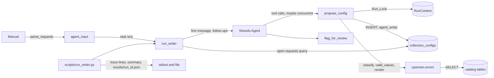

# Design Document

## Overview

This design covers the agent that proposes collection configurations as drafts, one per request, with Strands Agents on Amazon Bedrock:

- `agent_input(root, installation_id="install-07")` in `opsmem/manual.py`: the text the agent reads.
- `opsmem/writer.py`: `RunContext`, `make_tools`, the agent and model builders, and `run_writer`.
- `scripts/run_writer.py`: one run on `install-07`, printed and saved.
- The dependency `strands-agents==1.64.0` in `pyproject.toml` and `uv.lock`.
- The README step `### 4. One writer run`.

Key design decisions:

- The design is derived from the requirements only. Where the requirements leave a point open, the choice is written in "Open points" below.
- The agent reads only the request texts. Everything else (service, field, unit, sampling) is learned from the rejections, so the quality of the rejection text is what the experiment measures.
- The rejection text is not built here. `classify`, `valid_values` and `render` of `opsmem/errors.py` are called in that order, and the Instruction table stays in one place.
- One lock per run, held in the `RunContext`, covers the whole body of `propose_config`. Strands runs the tool calls of one turn concurrently, so without the lock the stop check, the insert and the escalation decision of different calls could interleave and a call could reach the database after the run was stopped.
- Strands is installed and imported normally. Unit tests replace the model side with a fake agent and the database side with a fake database. They do not replace Strands.
- No commit, no push and no model call happens while the spec is written.

### What I verified in the existing code

I read `sql/schema.sql`, `opsmem/db.py`, `opsmem/errors.py`, `opsmem/manual.py`, `pyproject.toml`, `.gitignore` and the instructive-rejections spec before writing this design.

| Fact | Where | Consequence |
|---|---|---|
| `agent_writer` can INSERT only the ten columns `run_id`, `installation_id`, `request_id`, `service_id`, `signal_name`, `signal_type`, `source_field`, `unit`, `sample_s`, `model_id` | `sql/schema.sql` | The insert names exactly these ten columns. `status` takes its default `draft`, `created_by` takes `current_user` |
| `agent_writer` has `UPDATE (status)` and the trigger `config_transition` allows only `draft` to `needs_review` for this role | `sql/schema.sql` | The escalation update sets `status = 'needs_review'` only where `status = 'draft'` |
| `agent_writer` has SELECT on `collection_configs` and on the catalog tables | `sql/schema.sql` | The Open_Request query and `valid_values` work with the one Database_Object of the run |
| `sample_s` is `integer`. A text that is not a number fails with `invalid input syntax for type integer` (SQLSTATE `22P02`) | `sql/schema.sql`, `opsmem/errors.py` | `CAST(:sample_seconds AS integer)` makes this a Database rejection, and `classify` returns `integer_input` |
| `run(sql, **params)` takes only `str`, `int`, `float`, `bool` and `None` values. `:name` is a parameter unless it follows another colon or a word character | `opsmem/db.py` | `CAST(:sample_seconds AS integer)` is scanned as a parameter. The value is passed as a `str` |
| `DatabaseError` is an attribute of the Database_Object and `str(err)` is the native message | `opsmem/db.py` | `except ctx.db.DatabaseError as err` and `str(err)` as the raw message |
| `check_config(required)` stops with `Configuration error, agent not started. Missing: ...` and exit 1. In local mode it requires `OPSMEM_LOCAL_PG` and `AWS_REGION` | `opsmem/db.py` | The script calls it first, like `scripts/apply_schema.py` |
| `parse_requests(text)` returns `Request` objects in table order with `request_id` and `request_text`, and raises `ManualError` when the section is missing | `opsmem/manual.py` | `agent_input` reuses it and does not parse the table again |
| `MANUAL` is a path relative to the repository root, and the parsers take text and read no file | `opsmem/manual.py` | `agent_input(root, ...)` is the one function of the module that reads a file. Its docstring says so |
| `render` raises `ValueError` for a Run_Mode other than `raw` or `instructive` | `opsmem/errors.py` | The script validates the option; the module needs no second check |
| `results/` is in `.gitignore` | `.gitignore` | The saved run files are not committed |
| `pyproject.toml` pins every dependency with `==`; `boto3==1.43.127` and `pyyaml==6.0.3` are in `[project]` | `pyproject.toml` | `strands-agents==1.64.0` goes in the same list |

## Architecture



Flow of one `propose_config` call, all under the Run_Lock:

1. Count the call. If the count exceeds 40 and the run is not stopped, stop it.
2. If the run is stopped: reply `STOPPED. ...`, no statement, append the trace entry.
3. Insert the draft. On success: reply `Saved as draft: ...`.
4. On `DatabaseError`: classify, count the pair `(request_id, rule)`. At 3: stop, move the drafts to `needs_review`, reply `STOPPED. The same rule rejected 3 times; ...`. Below 3: in `instructive` mode read the valid values, render, reply.
5. Append the trace entry, release the lock, return the reply.

## Components and Interfaces

### `agent_input`

```python
# opsmem/manual.py
def agent_input(root, installation_id: str = "install-07") -> str:
    """The text the writer agent reads: the installation and the request texts, nothing else.

    This is the one function of the module that reads a file: MANUAL under ``root``.
    """
    text = (Path(root) / MANUAL).read_text(encoding="utf-8")
    lines = [f"Installation: {installation_id}", "Requests:"]
    lines += [f"{r.request_id}: {r.request_text}" for r in parse_requests(text)]
    return "\n".join(lines)
```

- The result has the shape of the requirements: `Installation: install-07`, `Requests:`, then `R1: Write latency of the media volume`, and so on, joined with `\n`, no trailing newline (2.2 to 2.4).
- `installation_id` goes only into the first line. It is not checked against the Database; the Manual belongs to one installation.
- `Request.service_id`, `signal_type` and `sample_s` are not read, so they cannot appear (2.6). The request text is copied as `parse_requests` returns it. If a request text itself named a field, it would appear, because it is the text of the person who made the request. The test on the real Manual checks that the 6 texts do not.
- A missing section raises `ManualError` from `parse_requests` and is not caught (2.7).
- The module docstring of `manual.py` currently says the parsers read no file. The task that adds the function also changes that sentence, so it stays true: the parsers take text, and `agent_input` is the one reader.

### RunContext

```python
# opsmem/writer.py
from __future__ import annotations

import os
import threading
from dataclasses import dataclass, field

from strands import Agent, tool
from strands.models import BedrockModel

from opsmem import errors

SYSTEM_PROMPT = (
    "Configure one signal per request with propose_config. If a call is rejected, use the valid values "
    "in the rejection and call the tool again. Stop only when every request is saved."
)
MAX_TOOL_CALLS = 40
ESCALATE_AFTER = 3
FOLLOW_UPS = 2
MAX_FINAL_TEXT = 2000

@dataclass
class RunContext:
    run_id: str
    installation_id: str
    model_id: str
    mode: str                      # "raw" or "instructive"
    db: object                     # Database_Object of the role agent_writer
    rejections: dict[tuple[str, str], int] = field(default_factory=dict)
    tool_calls: int = 0
    escalation_reason: str | None = None
    flagged: list[str] = field(default_factory=list)
    trace: list[dict] = field(default_factory=list)
    last_db_message: str | None = None
    lock: threading.Lock = field(default_factory=threading.Lock, repr=False)
```

- The five first fields are positional in the order of Requirement 4.1. The dataclass gives that order.
- `escalation_reason is not None` is the definition of Stopped_Run. A helper `_stop(ctx, reason)` sets the reason only when it is none, so the first reason stays.
- `lock` is a plain `threading.Lock`. The body of a call never takes it twice, so no re-entrant lock is needed. Strands runs sync tools in worker threads, so a thread lock is the right kind.
- The Run_Context holds `rejections` with tuple keys. The result dictionary turns them into `"<request_id>:<rule>"` strings.

### Tools

```python
def make_tools(ctx: RunContext) -> list:
    @tool
    def propose_config(request_id: str, service_id: str, signal_name: str, signal_type: str,
                       source_field: str, unit: str, sample_seconds: str) -> str:
        """Propose one signal configuration as a draft.

        Args:
            request_id: request id
            service_id: service id
            signal_name: signal name
            signal_type: signal type
            source_field: source field
            unit: unit
            sample_seconds: sampling interval in seconds
        """
        call = {"request_id": request_id, "service_id": service_id, "signal_name": signal_name,
                "signal_type": signal_type, "source_field": source_field, "unit": unit,
                "sample_seconds": sample_seconds}
        with ctx.lock:
            result, db_message = _propose(ctx, call)
            ctx.trace.append({"ts": _now(), "call": call, "result": result, "db_message": db_message})
            return result

    @tool
    def flag_for_review(reason: str) -> str:
        """Ask a person to decide something you cannot.

        Args:
            reason: what you cannot decide
        """
        with ctx.lock:
            ctx.flagged.append(reason)
        return "Noted for a person. Continue with the signals you can configure."

    return [propose_config, flag_for_review]
```

- Strands builds the tool spec from the function name, the first paragraph of the docstring (description), the type hints (all `string`, all required because no parameter has a default) and the `Args:` section (parameter descriptions). The order of the signature is the order of the properties. A test reads `tool.tool_spec` and compares name, description, property order, property descriptions, types and `required` with the literals of Requirement 5. The docstrings carry no other text, so the spec is exactly the contract.
- The docstring of the Propose_Tool has no extra paragraph, because Strands joins the description paragraphs into the tool description.
- The trace is appended inside the lock, in the same critical section as the decision, so the trace order is the order in which the calls were decided (7.1, 8.1).
- The Flag_Tool is not traced. Requirement 7 speaks of the Propose_Tool only. The flagged reasons are in the result.

### The body of `propose_config`

```python
INSERT_SQL = (
    "INSERT INTO collection_configs (run_id, installation_id, request_id, service_id, signal_name,"
    " signal_type, source_field, unit, sample_s, model_id)"
    " VALUES (:run_id, :installation_id, :request_id, :service_id, :signal_name, :signal_type,"
    " :source_field, :unit, CAST(:sample_seconds AS integer), :model_id)"
)
MOVE_SQL = (
    "UPDATE collection_configs SET status = 'needs_review' "
    "WHERE run_id = :run_id AND installation_id = :installation_id AND status = 'draft'"
)

def _propose(ctx, call):
    ctx.tool_calls += 1
    if ctx.tool_calls > MAX_TOOL_CALLS:
        _stop(ctx, f"more than {MAX_TOOL_CALLS} tool calls")
    if ctx.escalation_reason is not None:
        return (f"STOPPED. This run is waiting for a person ({ctx.escalation_reason}). "
                "Do not propose more configurations."), None
    try:
        ctx.db.run(INSERT_SQL, run_id=ctx.run_id, installation_id=ctx.installation_id,
                   model_id=ctx.model_id, **call)
    except ctx.db.DatabaseError as err:
        return _rejected(ctx, call, str(err)), str(err)
    return (f"Saved as draft: {call['signal_name']} <- {call['source_field']} "
            f"({call['unit']}, every {call['sample_seconds']} s). A person will review it."), None

def _rejected(ctx, call, message):
    ctx.last_db_message = message
    rule = errors.classify(message)
    key = (call["request_id"], rule)
    ctx.rejections[key] = ctx.rejections.get(key, 0) + 1
    if ctx.rejections[key] >= ESCALATE_AFTER:
        _stop(ctx, f"rule {rule} rejected {ESCALATE_AFTER} times")
        ctx.db.run(MOVE_SQL, run_id=ctx.run_id, installation_id=ctx.installation_id)
        return "STOPPED. The same rule rejected 3 times; a person will take over. Stop now."
    valid = []
    if ctx.mode == "instructive":
        proposal = {**call, "sample_s": call["sample_seconds"]}
        valid = errors.valid_values(ctx.db, rule, proposal, ctx.installation_id)
    return errors.render(rule, valid, ctx.mode, message)
```

Notes, in terms of the requirements:

- The call is counted first (6.1). The 41st call has `tool_calls == 41 > 40`, stops the run with `more than 40 tool calls` (6.2) and then takes the STOPPED branch, so it sends no statement (6.3). A run already stopped keeps its first reason.
- `sample_seconds` is passed as a `str` and converted in SQL (6.5). `"every minute"` reaches PostgreSQL as text, fails with `22P02` and is classified as `integer_input`.
- The `DatabaseError` branch catches nothing else. `ConfigError`, `ConnectionFailed` and programming errors propagate to Strands, which reports a tool error to the model. The lock is released by `with`.
- The stop is set before the status update (6.9, 6.10). If the update raises `DatabaseError`, the run is still stopped and the error propagates. This is the safe order: the lock is held, and later calls find the run stopped.
- The escalation message string `STOPPED. The same rule rejected 3 times; a person will take over. Stop now.` is a literal. It says `3` and is the same literal as in the requirement. The Escalation_Reason uses `ESCALATE_AFTER`, whose value is 3, which gives `rule <rule> rejected 3 times`.
- The Rejection_Count is per pair of request id and rule (6.8). Different requests with the same rule, or the same request with different rules, do not add up.
- The third rejection does not read the valid values, because the agent is told to stop (6.11 and 6.12 cover the other cases).
- The valid values are read only in `instructive` mode (6.13, 6.14). In `raw` mode no statement besides the insert is sent.
- `valid_values` uses the same Database_Object, which is the `agent_writer` one, as the module docstring of `errors.py` requires.
- Nothing in `_propose` mentions the Instruction table (6.15).
- The raw message is returned with the reply so the trace keeps it whatever the agent was shown (7.6).

### Concurrency

Strands runs the tool calls of one model turn concurrently. The body of `propose_config` runs entirely inside `with ctx.lock:`. This gives three guarantees:

- The stop check and the insert of one call are atomic with respect to other calls. A call cannot pass the check, wait, and insert after another call stopped the run.
- The escalation decision, the change of status and the append to the trace are in the same critical section. A call that sees the run stopped always sees the final state.
- The count of tool calls is taken inside the lock, as the first step of the body (Requirement 6.1). Two concurrent calls cannot read the same count, so the cap of 40 has no race and the order of the counts is the order of the decisions.

Cost: calls of one run are serialized, so the insert latencies add up. A run has at most 40 calls plus a few, so this does not matter for the experiment. Calls of different runs use different Run_Contexts and do not share a lock.

The Flag_Tool takes the same lock, only for the `append`, so no reason is lost (8.5).

### Agent and model

```python
def build_agent(ctx: RunContext):
    model = BedrockModel(model_id=ctx.model_id, region_name=os.environ["AWS_REGION"], temperature=0)
    return Agent(model=model, tools=make_tools(ctx), system_prompt=SYSTEM_PROMPT, callback_handler=None)
```

- Keyword arguments only, nothing else (3.2, 3.3). No region name is written in the module (3.4). A missing `AWS_REGION` raises `KeyError` and is not caught (3.5).
- `build_agent` is a separate function so a test can replace `BedrockModel` and `Agent` in the module namespace with recorders and check the exact keyword arguments, without a network.

### Run loop

```python
OPEN_SQL = (
    "SELECT request_id FROM signal_requests WHERE installation_id = :installation_id "
    "AND request_id NOT IN (SELECT request_id FROM collection_configs "
    "WHERE run_id = :run_id AND installation_id = :installation_id)"
)

def run_writer(ctx, task, agent=None) -> dict:
    agent = agent or build_agent(ctx)
    result = agent(task)
    follow_ups = 0
    while ctx.escalation_reason is None:
        open_ids = _open_requests(ctx)
        if not open_ids:
            break
        ids = ", ".join(open_ids)
        if follow_ups == FOLLOW_UPS:
            _stop(ctx, f"agent stopped with requests not configured: {ids}")
            break
        result = agent(f"Not configured yet: {ids}. Call propose_config for each.")
        follow_ups += 1
    return _result(ctx, result, follow_ups)

def _open_requests(ctx):
    rows = ctx.db.run(OPEN_SQL, installation_id=ctx.installation_id, run_id=ctx.run_id)
    return sorted(str(row[0]) for row in rows)
```

- The optional `agent` argument lets tests pass a Fake_Agent. The public call is `run_writer(ctx, task)`; with no agent it builds the real one with `build_agent(ctx)`.
- "Requests with no configuration in this run" is a database query (9.3). A request with a rejected attempt has no row, so it is open. A request saved as a draft that was later moved to `needs_review` has a row, so it is not open.
- The loop sends a Follow_Up only while the run is not stopped (9.7), with at most 2 Follow_Ups (9.2). When 2 are already sent and requests are still open, the run is stopped with the reason of 9.5 and no third message is sent.
- A Follow_Up may itself stop the run (escalation or the cap). The loop then ends at the next test of `escalation_reason`.
- The ids are sorted in Python with `sorted` on strings, so the order does not depend on the collation of the database. `R10` sorts before `R2`; the Manual has `R1` to `R6`, so this has no effect on the real data.
- Usage and text: the Strands agent keeps accumulated usage over all its calls, so the result of the last answer holds the total.

```python
def _result(ctx, result, follow_ups):
    usage = getattr(getattr(result, "metrics", None), "accumulated_usage", None) or {}
    return {
        "tool_calls": ctx.tool_calls,
        "rejections": {f"{rid}:{rule}": n for (rid, rule), n in ctx.rejections.items()},
        "follow_ups": follow_ups,
        "escalated": ctx.escalation_reason,
        "flagged": list(ctx.flagged),
        "trace": list(ctx.trace),
        "input_tokens": usage.get("inputTokens", 0),
        "output_tokens": usage.get("outputTokens", 0),
        "final_text": str(result)[:MAX_FINAL_TEXT],
    }
```

- Exactly the nine keys of Requirement 9.8. `escalated` is the reason text or `None`.
- A missing `metrics` or `accumulated_usage` gives 0 for both token counts (9.11).
- `final_text` is cut to 2000 characters (9.12).

### Script

```python
# scripts/run_writer.py
REQUIRED = ["CLUSTER_ARN", "AGENT_WRITER_SECRET_ARN", "AWS_REGION"]

def main(argv=None):
    args = parse_args(argv)                    # --model (required), --mode raw|instructive (default instructive)
    db.check_config(REQUIRED)                  # before any connection
    run_id = f"single-{args.mode}-{int(time.time())}"
    ctx = RunContext(run_id, INSTALLATION_ID, args.model, args.mode, db.connect("agent_writer"))
    result = run_writer(ctx, manual.agent_input(ROOT, INSTALLATION_ID))
    for entry in result["trace"]:
        print(json.dumps(entry))
    print(f"run={run_id} calls={result['tool_calls']} follow_ups={result['follow_ups']} "
          f"escalated={result['escalated']} input_tokens={result['input_tokens']} "
          f"output_tokens={result['output_tokens']}")
    path = ROOT / "results" / f"{run_id}.json"
    path.parent.mkdir(exist_ok=True)
    path.write_text(json.dumps(result, indent=2))
```

- `argparse` with `choices=("raw", "instructive")` rejects another mode with an error before any connection (10.4). `check_config` runs next and before `db.connect` and before the model (10.1). In local mode `check_config` requires `OPSMEM_LOCAL_PG` and `AWS_REGION`.
- The script imports like `scripts/apply_schema.py`: it puts the repository root on `sys.path`.
- The run id uses the integer Unix time at the start (10.5).
- The summary line format is a choice of this design, because the requirement lists only its content: `run=<id> calls=<n> follow_ups=<n> escalated=<reason or None> input_tokens=<n> output_tokens=<n>`.
- The result is saved with `json.dumps`. The trace holds only strings and `None`, so it serializes without a custom encoder.

## Data Models

| Name | Type | Notes |
|---|---|---|
| Run_Mode | `str` | `"raw"` or `"instructive"` |
| Call | `dict[str, str]` | The seven arguments of `propose_config`, in tool order |
| Trace_Entry | `dict` | `ts: str` (UTC ISO 8601 with milliseconds, for example `2025-01-31T09:15:42.123+00:00`), `call: dict`, `result: str`, `db_message: str or None` |
| Rejection_Count | `dict[tuple[str, str], int]` | Key `(request_id, rule)`. In the result: `"<request_id>:<rule>"` |
| Escalation_Reason | `str or None` | First reason set stays |
| Result | `dict` | Nine keys of Requirement 9.8 |

The timestamp is made with `datetime.now(timezone.utc).isoformat(timespec="milliseconds")`, which gives the offset `+00:00`. The trace requirement asks for "UTC timestamp in ISO format with milliseconds". The test parses `ts` with `datetime.fromisoformat` and checks the offset is zero and that the fractional part has 3 digits.

## Error Handling

| Situation | Behaviour | Requirement |
|---|---|---|
| Insert rejected by the Database | Reply with `render`, or STOPPED at the third rejection of one rule on one request | 6.7 to 6.12 |
| `sample_seconds` is not a number | Database rejection, rule `integer_input`, counted like any other | 6.5 |
| Rule is `unknown` | Counted as the pair `(request_id, "unknown")`, `render` gives `Rejected.` | 6.7, 6.8 |
| More than 40 calls | Stop with `more than 40 tool calls`, STOPPED reply, no statement | 6.2, 6.3 |
| Call after the run is stopped, also a concurrent one | STOPPED reply, no statement | 6.3, 8.3 |
| Agent stops with open requests after 2 Follow_Ups | Stop with `agent stopped with requests not configured: <ids>` | 9.5 |
| Missing section in the Manual | `ManualError` reaches the caller | 2.7 |
| `AWS_REGION` not set | `KeyError` reaches the caller | 3.5 |
| `--mode` other than `raw` or `instructive` | `argparse` error before any connection | 10.4 |
| Missing configuration | `check_config` message and exit 1 | 10.1 |
| Any exception that is not `DatabaseError` (`ConfigError`, `ConnectionFailed`, `TypeError`) | Propagates. Strands reports a tool error to the model; the lock is released | by design |
| The status update at escalation raises `DatabaseError` | Propagates. The run is already stopped | 6.9 |

## Open points

1. Moving the drafts. Requirement 6.10 asks for the move to `needs_review` at the escalation by the third rejection only. A stop by the cap of 40 calls or by the follow-up rule does not move the drafts, because the requirements do not ask for it. The drafts stay `draft`, which is the status a person reviews.
2. The Flag_Tool is not traced, because Requirement 7 names the Propose_Tool only.
3. The count of tool calls includes the calls made after the run was stopped, so `tool_calls` can be larger than 40 after the cap.
4. The summary line has a fixed format of this design (see "Script"). The requirement fixes its content, not its layout.
5. The timestamp offset is written `+00:00`, the output of `isoformat`.
6. The Fake_Agent is a callable that takes a message and returns an object with `metrics.accumulated_usage` and `__str__`. It stands in for the Strands agent in `run_writer`, and for the model in the concurrency test the tools are called directly from threads.

## Correctness Properties

_A characteristic or behavior that should hold true across all valid executions of the system, stated formally. These statements bridge the human-readable requirements and machine-verifiable correctness guarantees._

Reflection on redundancy: the prework gave about 25 testable criteria. I merged them as follows:

- 2.1 to 2.5 are one shape property. 2.6 stays separate, because it checks absence of other columns.
- 6.1 and 6.2 are one property about the count and the cap. 6.3 and 8.3 are one property: a stopped run never touches the Database.
- 6.4 to 6.6 are one property about the insert and the saved reply. 6.7 to 6.12 are one property against a counting oracle. 7.1 to 7.7 are one trace property over the same generated calls.
- 8.1 to 8.4 are one concurrency property. 9.1 to 9.7 are one loop property. 9.8 to 9.12 are one result property.
- Criteria about constants, specs, fixed strings, the script and the README are examples or smoke checks, not properties.

### Property 1: Agent input has the fixed shape

*For any* non-empty table of requests and any installation id, `agent_input` returns the string made of `Installation: <installation_id>`, `Requests:` and one line `<request_id>: <request_text>` per request in table order, joined with `\n`, with no trailing newline.

**Validates: Requirements 2.1, 2.2, 2.3, 2.4, 2.5**

### Property 2: Agent input hides everything but the request texts

*For any* table of requests whose service ids, signal types and sampling cells hold marker values that occur nowhere in the request ids and texts, the string returned by `agent_input` contains none of those markers.

**Validates: Requirements 2.6**

### Property 3: Flagging records the reason and gives the fixed reply

*For any* sequence of reason strings, calling `flag_for_review` with each in order leaves the flagged reasons equal to the sequence, and every reply equals `Noted for a person. Continue with the signals you can configure.`

**Validates: Requirements 5.6, 5.7**

### Property 4: Calls are counted and the 41st call stops the run

*For any* number n of calls between 1 and 60 to `propose_config` on a database that accepts every insert, the number of tool calls equals n, the first 40 calls each send one insert, and every call after the 40th replies with the STOPPED text for the reason `more than 40 tool calls` and sends no statement.

**Validates: Requirements 6.1, 6.2, 6.3**

### Property 5: A stopped run never reaches the database

*For any* call arguments, when the run is already stopped with any reason, `propose_config` replies `STOPPED. This run is waiting for a person (<reason>). Do not propose more configurations.` and the Fake_Database records no statement.

**Validates: Requirements 6.3, 8.3**

### Property 6: A saved draft is answered and inserted as given

*For any* seven argument strings on a database that accepts the insert, the reply equals `Saved as draft: <signal_name> <- <source_field> (<unit>, every <sample_seconds> s). A person will review it.`, the insert binds the run id, installation id, model id and the seven arguments unchanged, `sample_seconds` is bound as a string, and the SQL text converts it with `CAST(:sample_seconds AS integer)`.

**Validates: Requirements 6.4, 6.5, 6.6**

### Property 7: Escalation happens exactly when one rule is rejected 3 times on one request

*For any* sequence of calls on a database that rejects each call with a message that names a rule, in either Run_Mode, a counting oracle over the pairs `(request_id, rule)` decides the outcome of every call: before any pair reaches 3, the reply equals `render` for the Run_Mode, the rule, the raw message and the valid values; at the call where a pair reaches 3, the run is stopped with `rule <rule> rejected 3 times`, one status update for the run is sent and the reply is `STOPPED. The same rule rejected 3 times; a person will take over. Stop now.`; every later call replies with the STOPPED text and sends no statement. In `raw` mode no lookup statement is sent.

**Validates: Requirements 6.7, 6.8, 6.9, 6.10, 6.11, 6.12, 6.13, 6.14**

### Property 8: The trace has one entry per call

*For any* sequence of calls with any mix of accepted, rejected and stopped outcomes, the trace holds one entry per call in call order, each entry has exactly the keys `ts`, `call`, `result` and `db_message`, `ts` is a UTC ISO 8601 time with milliseconds, `call` equals the arguments, `result` equals the reply, and `db_message` equals the raw message of the rejection or none for the other outcomes.

**Validates: Requirements 7.1, 7.2, 7.3, 7.4, 7.5, 7.6, 7.7**

### Property 9: No call after the escalation reaches the database

*For any* number of concurrent calls between 4 and 12, in which every insert is rejected for the same rule on the same request, the Fake_Database records exactly 3 inserts, the run is stopped once, and no insert is recorded after the status update. Every call that did not reach the database replies with the STOPPED text.

**Validates: Requirements 8.1, 8.2, 8.3, 8.4**

### Property 10: The run loop sends follow-ups until requests are configured or the budget is spent

*For any* table of requests and any behavior of a Fake_Agent that configures an arbitrary subset of the open requests on each message, the Run_Runner sends the first message `task`; sends a Follow_Up `Not configured yet: <ids joined by ", ">. Call propose_config for each.` with the open ids in ascending order after each answer that leaves requests open, while fewer than 2 Follow_Ups were sent; sends none when no request is open or the run is stopped; and when 2 were sent and requests are still open, stops the run with `agent stopped with requests not configured: <ids joined by ", ">`.

**Validates: Requirements 9.1, 9.2, 9.3, 9.4, 9.5, 9.6, 9.7**

### Property 11: The result has the fixed keys and bounded text

*For any* run state, any final answer text and any usage record that may lack the token fields, `run_writer` returns a dictionary with exactly the keys `tool_calls`, `rejections`, `follow_ups`, `escalated`, `flagged`, `trace`, `input_tokens`, `output_tokens` and `final_text`; every key of `rejections` is `<request_id>:<rule>` for a pair that was counted; missing tokens give 0; and `final_text` is the answer cut to at most 2000 characters.

**Validates: Requirements 9.8, 9.9, 9.10, 9.11, 9.12**

## Testing Strategy

Dual approach. Property tests cover the universal properties above. Example tests cover the contract strings, the specs, the script and the construction of the model and the agent.

### Property-based tests

- Library: `hypothesis` (already in the dev group). No new test dependency.
- At least 100 examples per property: `@settings(max_examples=100)` or higher. Property 9 uses fewer examples with real threads if the run time is too long; it keeps at least 100 examples and short sleeps.
- Each test carries a tag comment: `# Feature: writer-agent, Property <n>: <text>`.
- Files: `tests/test_agent_input.py` for Properties 1 and 2, `tests/test_writer_tools.py` for Properties 3 to 8, `tests/test_writer_concurrency.py` for Property 9, `tests/test_writer_run.py` for Properties 10 and 11.

Test doubles, in `tests/writer_fakes.py`:

- `FakeDatabase`: `DatabaseError = db.DatabaseError`, `run(sql, **params)` that appends `(sql, params)` to a list under a small internal lock, and answers by the start of the SQL. An insert is accepted or raises `DatabaseError(message)` according to a function given at construction. The `UPDATE` of the escalation is recorded. `SELECT` statements of `valid_values` return rows from a small in-memory catalog. The open-request query returns the ids that the test says are open. An optional per-insert delay lets the concurrency test make threads overlap.
- `FakeAgent`: a callable `agent(message)` that records the message, runs a function given by the test (which calls `propose_config` on the real tools to create drafts in the Fake_Database) and returns an object with `metrics.accumulated_usage` and `__str__`.
- Strands is not replaced. The tools are the real `@tool` objects of `make_tools`. A test calls them as plain callables, which the Strands decorator allows.

Generators:

- Calls: seven `st.text(min_size=1)` values with an alphabet that has no `\n`, plus request ids from a small pool such as `R1` to `R6`, so the same pair repeats often enough to reach 3.
- Rejection messages: the shapes of the instructive-rejections design, with a rule name drawn from `sorted(INSTRUCTIONS)`.
- Request tables for Properties 1 and 2: a manual text built from the real heading `## Requests from operations` and a markdown table, written to `tmp_path / MANUAL`. Marker values for the hidden columns use an alphabet (digits and an upper-case prefix such as `ZZ`) that the id and text alphabets exclude.
- Property 7 oracle: a `Counter` over `(request_id, rule)` that mirrors the requirement, written independently of the code under test.
- Property 9: `threading.Barrier` releases N threads that call `propose_config` together. The Fake_Database sleeps a few milliseconds in each insert, so that without the lock several threads would pass the stop check together. The test reads the recorded statement list: exactly 3 inserts, one `UPDATE`, and no insert after the `UPDATE`.

### Example-based unit tests

- 1.1, 1.2: `pyproject.toml` lists `strands-agents==1.64.0` in `[project].dependencies` next to the two others; `uv.lock` has the package at 1.64.0.
- 1.3: importing `opsmem.writer` gives a real `strands` module (`Agent` is the Strands class).
- 2.7: a manual text without the heading raises `ManualError`.
- 2.6 on the real Manual: `agent_input(ROOT)` equals the six lines expected, and contains no field name, unit, sampling value or service id of `install-07` (the lists are written by hand in the test).
- 3.1: `SYSTEM_PROMPT` equals the literal.
- 3.2, 3.3: with `BedrockModel` and `Agent` replaced in the module namespace by recorders, `build_agent` calls them with exactly the keyword arguments of the requirement and the region from `AWS_REGION`; changing the variable changes the argument.
- 3.4: the source of `opsmem/writer.py` contains no `us-east-1`.
- 3.5: without `AWS_REGION`, `build_agent` raises `KeyError`.
- 4.1 to 4.9: a new `RunContext` has the defaults and the constants equal 40, 3 and 2.
- 5.1 to 5.5: `make_tools` returns two tools in order; their `tool_spec` has the names, descriptions, property order, property descriptions, types `string` and the required list of the requirement.
- 5.7 and 8.5: several threads calling `flag_for_review` keep every reason.
- 6.13, 6.14: in `raw` mode only the insert is sent; in `instructive` mode the lookup statement of the rule follows.
- 6.15: the source of `opsmem/writer.py` does not contain the text `Unknown source_field`.
- 11.2: three rejections of one rule on `R1` stop the run, send the status update and give the STOPPED reply (the named example of the brief).
- 11.3: the 41st call stops the run with `more than 40 tool calls`.
- 10.1 to 10.9: the script is loaded by path as in `tests/helpers.py`, with `run_writer` and `db.connect` replaced. The test checks that `check_config` is called first, that an invalid `--mode` stops before `connect`, that the default mode is `instructive`, that the run id matches `single-<mode>-<digits>`, that one JSON line per trace entry is printed and then the summary line, and that `results/<run_id>.json` holds the result.

### Integration test (one, not a property)

- `tests/test_writer_pg.py`, marked `local_pg` like `tests/test_errors_pg.py`, using `tests/pghelpers.py`. It builds a `RunContext` with the `agent_writer` Database_Object and calls the real tools: a valid proposal for `R1` is saved as a draft with `sample_seconds` given as text; a non-numeric `sample_seconds` is rejected as `integer_input`; three rejections of one rule on one request stop the run and the earlier draft is moved to `needs_review`; the Open_Request query returns the requests without a row. This is the only test that proves the SQL text runs on PostgreSQL with the real grants and the `config_transition` trigger. It does not call a model.

### README step "One writer run"

Placement and rules follow Requirement 12: the step goes under `## Part 1: the database says no` as `### 4. One writer run`, and the local section `## Run it locally, paying only for the model` gets the run command. The README task calls no model. It stops and asks the user to paste the real trace and the real summary line produced by `scripts/run_writer.py`, and then writes the step in the first person with that output unedited. It describes only what the code implements. Nothing is shown that was not run.
